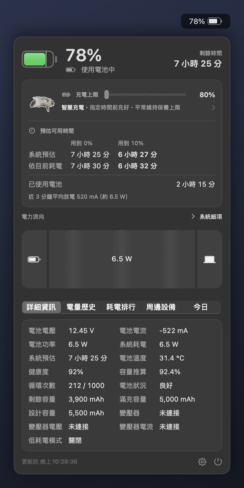
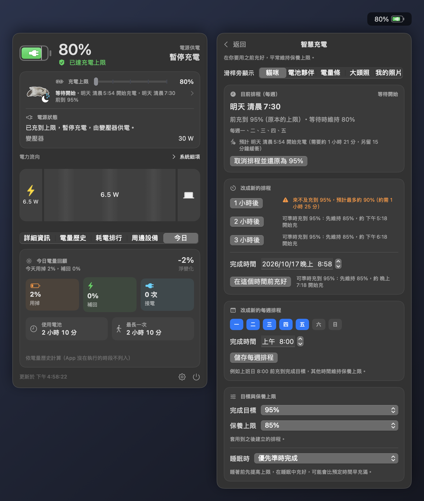
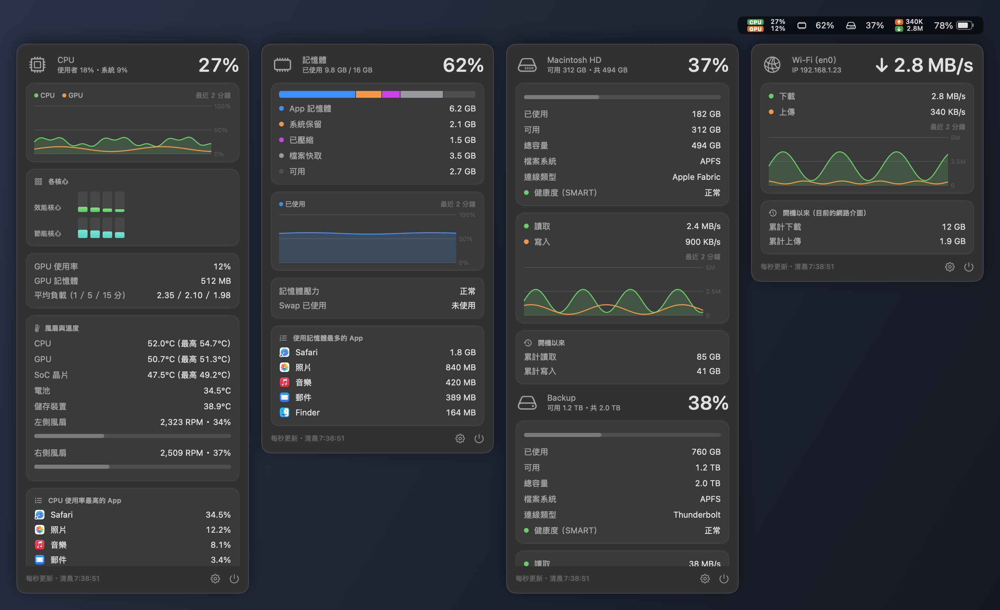
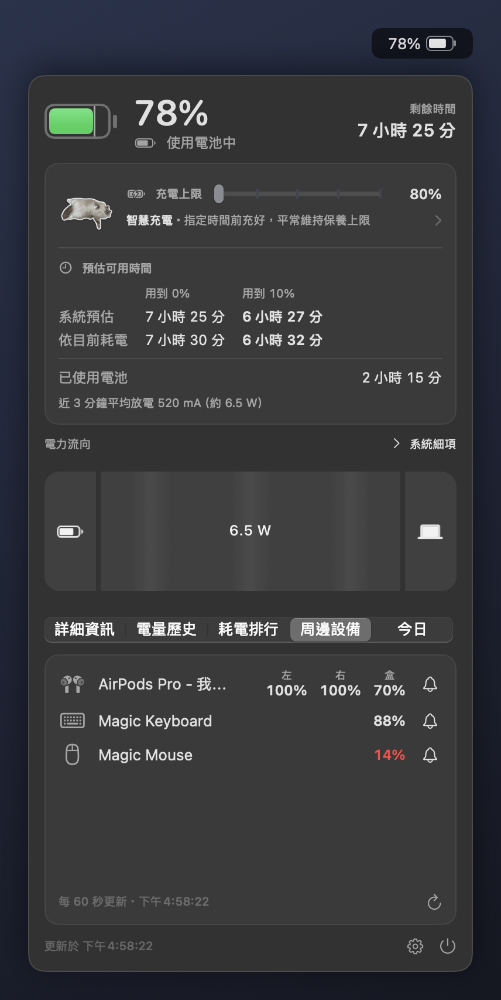
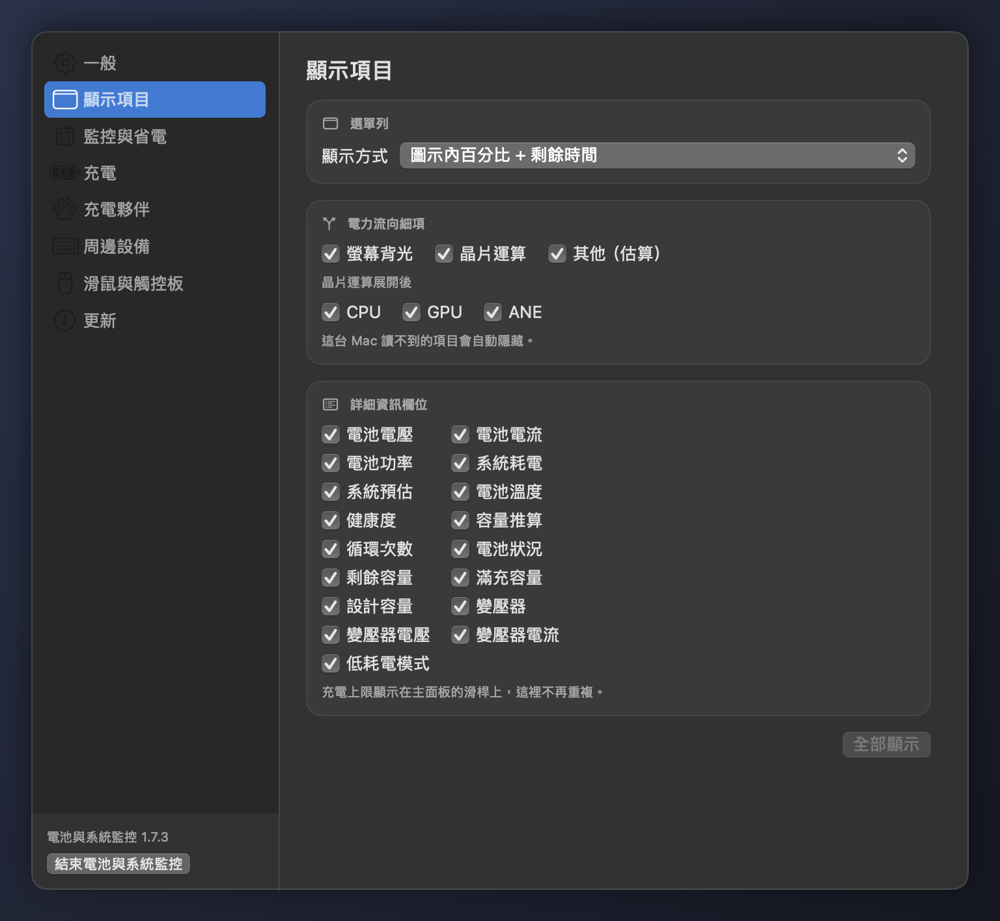
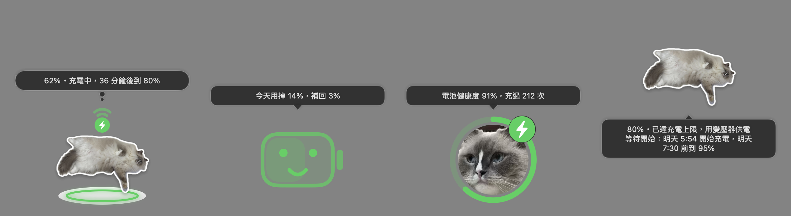
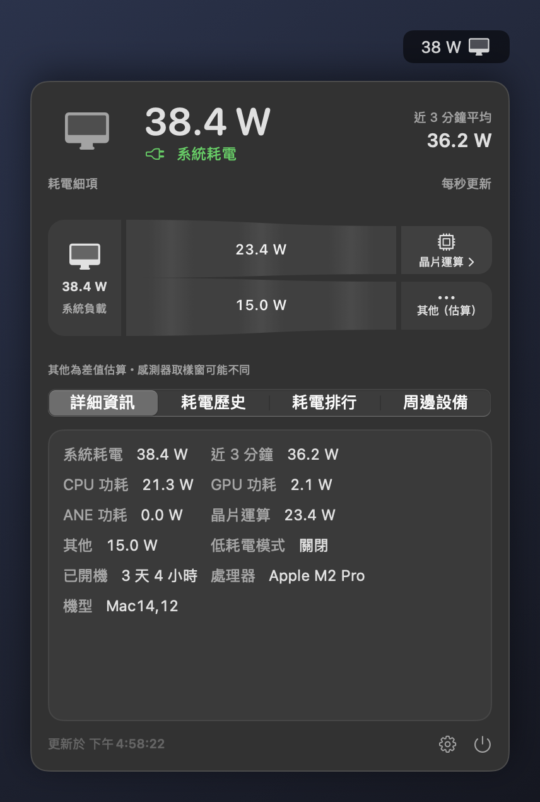
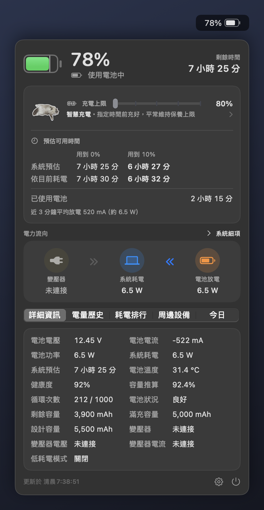

[繁體中文](README.md) | **English**

# Battery & System Monitor (macbookBatteryMonitor)

A macOS menu bar app for battery and system information. On a MacBook the menu bar shows the charge level. Click it to see:
- time remaining, battery health and power flow (expandable down to individual components);
- a charge limit slider and smart charging;
- history charts, a daily recap and the apps using the most energy;
- the battery levels of Bluetooth keyboards, mice and headphones.

Desktop Macs (Mac mini, iMac, Mac Studio, Mac Pro) show whole-system power instead. System monitors for CPU/GPU, memory, disks and network can be turned on or off.

The app's interface is in Traditional Chinese. This README quotes the Chinese labels with an English translation in parentheses.



## Highlights

- **One app for every Mac**: Apple silicon and Intel, MacBooks and desktops use the same download, which decides by itself whether to show the battery or system power. Macs on macOS 12 or 13 have a separate build
- **Charge limit slider**: drag macOS's charge limit (80–100%) right in the panel. It is the same setting as in System Settings, kept in sync both ways, and needs no admin rights
- **Smart charging**: say "charged to X% by this time"; the Mac stays at a battery-friendly limit and macOS only charges to the target when it's time
- **Power flow**: watts between the power adapter, the system and the battery, expandable to the display backlight and CPU/GPU/ANE
- **Charging companion and desktop pet**: a breathing cat, a battery with a face, a charge bar or a photo that follows the charging state, also available as a pet on the desktop
- **Peripheral batteries**: Bluetooth keyboards, mice and trackpads (including Logitech, Razer and other Bluetooth LE devices) and the left bud, right bud and case of AirPods, each with its own low-battery notification
- **System monitors**: CPU/GPU (with fans and temperatures), memory, disks (including external drives and drive health) and network (with a speed test), one menu bar icon each, or one shared icon for memory and disk; one switch turns them all off
- **Separate mouse and trackpad scroll directions**: for example natural scrolling on the trackpad and the traditional direction on the mouse wheel
- **Login items**: lists the apps, agents and daemons that start at login, shows what each one is and where it comes from, and lets you clear the user-level config files an uninstalled app left behind; system-level items are view-only
- **Light on power**: updates every second by default and uses about 0.2% CPU with the panel closed; slower update intervals and a power saving mode are available
- **Keep awake**: the cup at the bottom right of the panel keeps the Mac awake for 30 minutes, 1 hour, 2 hours or until turned off, optionally with the display on too, and shows the time left. It stops by itself on battery at 10% or below. You can also list apps in Settings → 監控與省電 that keep the system awake while any of them runs (the display still sleeps), released when they all quit; it only listens for apps launching and quitting, with no polling. Uses the public power management API; quitting the app releases it
- **Bluetooth off during sleep** (laptops only; on a desktop Mac idle Bluetooth keyboards and mice disconnect by themselves, so turning Bluetooth off would leave only the power button to wake it): turns Bluetooth off when the Mac sleeps and back on when it wakes, only if it was the one that turned it off. It stays on while a Bluetooth keyboard, mouse or trackpad is connected, and in clamshell mode (lid closed, running on an external display; simply closing the lid to sleep still turns it off), so the Mac can still be woken. After waking it checks that Bluetooth really came back on and retries if not (up to 5 times, then again on the next wake or launch). Uses private macOS functions (loaded at run time; the option is hidden if they are missing), tested on macOS 27 only
- **One-click updates that keep permissions**: one click in Settings downloads, verifies and installs the new version; only versions carrying the publisher's update signature and signed with the same certificate are installed; Accessibility and Bluetooth permissions don't have to be granted again
- **Never changes charging behind your back**: the charge limit only changes when you drag the slider or set up smart charging; macOS itself stops charging at the limit
- **No Xcode needed**: the Command Line Tools are enough to build it

## Download

| Your Mac | Download (latest) |
|---|---|
| macOS 14 or later (Apple silicon or Intel, MacBook or desktop) | [`macbookBatteryMonitor.dmg`](https://github.com/sgeric910601/macbookBatteryMonitor/releases/latest/download/macbookBatteryMonitor.dmg) (universal) |
| macOS 12 or 13 (Apple silicon or Intel) | [`macbookBatteryMonitor-macOS12.dmg`](https://github.com/sgeric910601/macbookBatteryMonitor/releases/download/v1.7.7/macbookBatteryMonitor-macOS12.dmg) (older macOS build, v1.7.7) |

- The universal build's file name never changes, so its link above always downloads the latest version; other versions are on [Releases](https://github.com/sgeric910601/macbookBatteryMonitor/releases)
- The older macOS build is for Macs on macOS 12 or 13 (for example 2015–2017 MacBooks, or older Macs upgraded with OpenCore Legacy Patcher). It stays at v1.7.7 for now, without the features added in v2.0.0. After the system is upgraded to macOS 14, one-click update switches to the universal build by itself
- Already on v1.7.2 or later: no download needed, use Settings → Update → "一鍵更新" (one-click update)
- Releases no longer include zips from v2.0.0: v1.7.1 first updates to v1.7.7 (v1.7.2 for the older macOS build) with one click, then one more click brings it to the latest version; one-click update in v1.5.0–v1.6.2 only understands zips, so download the DMG above and install it once

## Install

1. Download the matching DMG above and open it
2. Drag "電池與系統監控" (Battery & System Monitor) into Applications (the file is `macbookBatteryMonitor.app`), eject the DMG and open it from Applications. If you open it right inside the DMG, the app offers to open the copy in Applications instead; if it isn't there yet or is an older version, one click copies it over
3. macOS blocks the first launch (the app isn't signed with an Apple developer certificate). Allow it either way:
   - In System Settings → Privacy & Security, find the app near the bottom and click "Open Anyway"
   - Or run in Terminal:
     ```bash
     xattr -dr com.apple.quarantine /Applications/macbookBatteryMonitor.app
     ```
4. On the first launch, choose:
   - battery only, or battery plus system monitors (power only / power plus system monitors on desktops);
   - whether to turn on admin CPU sampling (Apple silicon);
   - whether to allow notifications and Bluetooth (Bluetooth is only used to read the battery of Logitech, Razer and similar mice and keyboards).

   The app adds itself to login items; you can turn that off in Settings.

**Permissions are kept**: every release is signed with the same dedicated certificate, so macOS treats new versions as the same app. Accessibility and Bluetooth permissions stay after one-click updates and reinstalls, with nothing to allow again. The certificate is self-made, not an Apple developer signature, so the first launch still has to be allowed as above. Updating from v1.7.3 or earlier switches signatures, so the permissions have to be allowed one last time:
- Bluetooth asks again; allow it;
- for Accessibility, follow "[If reversed scrolling stops working](#if-reversed-scrolling-stops-working)".

The app is named "電池與系統監控" (Battery & System Monitor on English systems); the bottom left of the Settings window shows the name and version.

## Using it

### Menu bar

- **Left click** the icon to open the panel; clicking anywhere else closes it. This also works while another app is in full screen (green button). **Right click**: open the panel, Settings, Quit
- **Display styles** (Settings → Display items): icon and percentage, icon only, percentage only, icon and time remaining, or percentage inside the icon plus time remaining (the charge inside the battery icon, time remaining or time to full on the right). The last one shows "—" without time data and "已充飽" (full), "接電" (plugged in) or "已達上限" (limit reached) when full, plugged in without charging, or at the charge limit
- A bolt while charging, a plug while plugged in without charging, red at low battery
- **System monitors**: one menu bar icon each. Left click opens that monitor's panel, right click opens Settings or quits; hold ⌘ and drag to reorder the icons
- **Memory and disk in one icon** (「記憶體與磁碟放在同一個圖示」 in Settings → Monitoring & power saving, off by default): two lines like CPU/GPU, memory on top and disk below; the memory value still turns orange or red under memory pressure. Its panel shows memory, then disk. Available only while both the memory and disk monitors are on
- **Combine into one icon** (Settings → Monitoring & power saving): when the menu bar is full, macOS hides the icons that don't fit (MacBooks with a notch are hit hardest). You can then keep just the battery icon (power on desktops). Clicking it opens a second status bar right below the menu bar with the battery and monitor icons, updated live. Click an icon there to open its panel (click again to collapse it); click anywhere else or press Esc to close the bar. The monitors only sample while the second bar is open. No screen recording or Accessibility permission is needed
- If you only see the battery icon and no CPU or other icons, check that the system monitor master switch is on in Settings → Monitoring & power saving

### Battery panel

- **Charge and time**: charge level, charging state, time remaining or time to full (to the charge limit when one is set); estimated time to 0% and to 10% (the system estimate, plus one from the 3-minute average draw); how long it has been on battery since you unplugged
- **Charge limit slider**: 80–100% in 5% steps. It writes when you let go, reads the value back to confirm the system applied it and tells you if it didn't; changes made in System Settings show up immediately. 100% means no limit. Macs whose system can't change the charge limit don't show the slider
- **Charging companion and smart charging**: the companion sits left of the slider and the smart charging status (waiting, charging, ready and so on) below it; click either to open the smart charging page (see "[Smart charging](#smart-charging)")
- **Power flow**: watts between the power adapter, the system and the battery. Click "系統" (System) to split it into display backlight, chip, and other (estimated), then click the chip for CPU/GPU/ANE; items the model doesn't have are hidden (see "[How power flow is measured](#how-power-flow-is-measured)")
- **Details**: battery voltage, current and power, system power, system estimate, battery temperature, health, computed health (full charge capacity ÷ design capacity), cycle count, battery condition, remaining, full charge and design capacity (mAh), Low Power Mode, power adapter rating, live adapter voltage and current, charge limit (shown only on the slider on Macs that have one)
- **Tabs**:
  - charge history (1 hour / 24 hours / 7 days; the first launch backfills the past few days from `pmset`);
  - today's recap: charge used and regained today, net change, plug-ins, total and longest time on battery;
  - top energy users: the top 5 apps, with child processes merged into their app;
  - peripherals.
- Every power flow item and every details field can be hidden in Settings → Display items
- When the panel is taller than the screen (small screens or zoomed display), it scrolls instead of being cut off



### System monitors

Pick "battery plus system monitors" on the first launch, or turn on the master switch later in Settings → Monitoring & power saving; each of the four monitors has its own switch. With the master switch off nothing is sampled, just like battery only.

- **CPU/GPU**: the menu bar shows CPU and GPU usage. The panel has:
  - the user/system split, a 2-minute chart, per-core usage (performance and efficiency cores), GPU memory, load average and the apps using the most CPU;
  - fans and temperatures: fan speed and share of maximum speed (hidden on fanless models), and CPU/GPU/SoC/battery/storage temperatures (unreadable ones are hidden).
- **Memory**: the menu bar shows usage, turning orange and red as memory pressure rises. The panel shows the breakdown into app memory, wired, compressed, cached files and free, plus a 2-minute chart, swap and the apps using the most memory
- **Disks**: the menu bar shows how full the startup disk is. The panel lists the startup disk and mounted external disks (USB, Thunderbolt, SD cards; not disk images or network volumes), each with used/free space, file system, connection type, health, read/write speed with charts and total reads/writes
  - NVMe drives keep their own record of how much of their rated life is used and how much has been read and written since they were made. Every Apple silicon Mac's internal drive is NVMe, as are most Intel Macs from 2016 on and Thunderbolt enclosures. Health is 100% minus the life used (3% used means 97%), the totals are the drive's lifetime totals, and power-on time is listed too, with an extra line if there are media errors. When the drive reports a critical warning or its spare blocks fall below the threshold, health shows a red "異常，建議立即備份" (failing, back up now)
  - Drives without that record (internal drives that aren't NVMe, such as a 2015 MacBook Air's, and most USB enclosures) show the SMART "正常／異常" (OK / failing) status, and totals since boot (since connected for external disks)
- **Network**: the menu bar shows upload and download speed; the panel shows the current interface (Wi-Fi, Ethernet) and IP, a speed chart and totals since boot
  - **Connection status**: whether a VPN is connected (a tunnel interface with a usable address; the system's own utun interfaces do not count), plus the system's Low Data Mode and metered network flags (for example a phone hotspot). It only looks at local interfaces and the system network path, watches only while the panel is open, and contacts no outside server
  - **Speed test**: off by default so it isn't started by accident; after turning on 「在網路面板顯示測速」 (show speed test in the network panel) in Settings → Monitoring & power saving, press 「開始測速」 (start test) at the bottom of the panel to run macOS's built-in `networkQuality` against Apple's test servers, which takes about 20–30 seconds. During the test the card shows live download and upload rates (all traffic on the interface, including other apps); afterwards it shows download, upload, responsiveness (RPM, round trips per minute while the network is busy; higher means less lag) and idle latency. You can stop it at any time; it keeps running when the panel closes, and the result is still there next time. A test uses several hundred MB, so mind your data plan on a mobile connection
- Child processes (such as browser tabs) are merged into their app



### Peripherals

The "周邊設備" (Peripherals) tab at the bottom of the panel lists the battery levels of connected Bluetooth keyboards, mice, trackpads and headphones:
- AirPods and similar headphones show "左" (left), "右" (right) and "盒" (case) side by side on one line;
- non-Apple Bluetooth LE mice and keyboards from Logitech, Razer and others show up too (Bluetooth permission required).

The bell to the right of each device sets its low-battery notification: off, or below 10%, 15%, 20%, 30% or 50% (20% by default). Settings → Peripherals sets them for all connected devices at once. Levels update every 60 seconds; the arrow at the bottom right refreshes them right away.



### Notifications

- **Low battery, fully charged**: adjustable thresholds; reaching the system charge limit notifies too. The low-battery alert still fires while plugged in if the battery is draining (adapter too weak or load too high)
- **Smart charging**: once when charged before the finish time, and once if it may not make it at the current rate
- **Peripherals**: once when a device drops below its own threshold, and again only after it has charged back above it
- **New versions**: see "[One-click update](#one-click-update)"
- When macOS has turned off notifications for the app, Settings → General → "通知" (Notifications) says so and can open the notification settings directly

### Settings window

Click the gear at the bottom right of the panel, or "設定…" (Settings…) in the menu bar icon's right-click menu. While it's open the app shows up in the Dock and ⌘Tab, so you can find it again after visiting System Settings; ⌘W closes it. The sections on the left:

| Group | Section | Contents |
|---|---|---|
| 基本 (Basic) | 一般 (General) | App icon color, notification thresholds, launch at login, settings backup (export, import) |
| | 顯示項目 (Display items) | Menu bar style, power flow items, details fields |
| | 監控與省電 (Monitoring & power saving) | Update interval, power saving mode, keep awake while listed apps run, Bluetooth off during sleep, system monitor master switch and each monitor, monitor alerts, memory and disk in one icon, network speed test, combine into one icon, admin CPU sampling |
| | 登入項目 (Login items) | What starts at login: list, add and remove, disable, and where each one comes from (see "[Login items](#login-items)") |
| | 權限 (Permissions) | The system permissions this app uses, whether each is granted, which features use it, and a button to the matching System Settings pane |
| 電池 (Battery) | 充電 (Charging) | Charge limit slider, smart charging |
| | 充電夥伴 (Charging companion) | Appearance, my photo, the desktop pet's position, size and moving eyes |
| | 周邊設備 (Peripherals) | Each device's low-battery notification, and the external displays, USB and Thunderbolt devices connected right now (built-in parts and USB hubs are left out; read only when the page opens) |
| 擴充功能 (Extensions) | 滑鼠、觸控板與鍵盤 (Mouse, trackpad & keyboard) | Scrolling, mouse side buttons, Chinese input methods, hold ⌘Q / ⌘W, keyboard cleaning (shown once one of them is on) |
| | 視窗切換 (Window switching) | The window switcher that replaces Cmd+Tab: shortcuts, appearance, which windows to list, exceptions |
| | 視窗與 Dock (Windows & Dock) | Window snapping, green button maximizes, Finder shortcuts, quit when the last window closes, click a Dock icon to minimize |
| | 功能管理 (Feature management) | Turn extension features on or off (see "[Extension features](#extension-features)") |
| 關於 (About) | 更新 (Update) | One-click update, automatic checks and new-version notifications |

Desktop Macs have no Charging or Charging companion sections. The panel's gear reopens the section you last viewed, "有新版本" (new version available) opens Update, and the gear in a monitor panel opens Monitoring & power saving.



## Smart charging

Needs a Mac whose charge limit the app can change: an Apple silicon MacBook that has "充電上限" (Charge Limit) in System Settings → Battery. Other Macs have no smart charging; the panel shows only the charging companion at the top.

**How to use it**: click the charging companion left of the slider, the status below the slider, or open Settings → Charging. You can choose:
- "1 小時後", "2 小時後" or "3 小時後" (in 1, 2 or 3 hours);
- a finish time;
- weekdays and a time, saved as a weekly schedule (for example 8:00 on workdays).

Before you pick, each option shows an estimate from the current charge and charging speed:
- in time: "可準時充到 95%：先維持 80%，約 8:07 開始充" (will reach 95% in time: hold 80%, start around 8:07);
- already close to the target: "會直接充到 95%" (will charge straight to 95%);
- not enough time: "來不及充到 100%，預計最多約 90%" (can't reach 100%, about 90% at most).

**How it works**

1. While waiting, the app sets macOS's charge limit to the care limit (80% by default). If the battery is already above the care limit, the limit isn't lowered below the current charge (macOS would drain to the care limit first and then charge back, an extra cycle for nothing); it stays at the current charge, rounded up to the next 5% step (95% at 93%)
2. The start time is worked back from the charging time needed: the current charging speed if it is charging, otherwise the median charging speed over the past seven days, otherwise 20% per hour. Charging slows above 80%, so that part takes 1.8 times longer, and 15 minutes of buffer are added
3. At the start time, the limit is raised to the target and macOS charges by itself. The target defaults to "原本的上限" (the original limit, the system charge limit when the schedule was created); choose 100% separately if needed. Once started, the limit isn't lowered again even if the estimate shrinks, so charging never stops halfway
4. A "已充到目標" (target reached) notification is sent when done. A one-time schedule restores the original charge limit after you unplug (or 2 hours after the finish time if you don't); a weekly schedule moves on to its next time
5. If it can't make the finish time at the current rate, the status shows "可能無法準時" (may be late) and notifies once; charging continues

The target and care limit are set under "目標與保養上限" (target and care limit) on the smart charging page and apply to schedules created afterwards.

- **Your own changes win**: if you drag the charge limit slider or change the limit in System Settings while a schedule is running, the app ends the schedule and neither changes it back nor restores it. "取消排程並還原" (cancel and restore) on the smart charging page restores the limit from before the schedule
- **Every write is checked**: the system limit is read back after writing and only counts as done when it matches; failed writes are retried after 1 minute, and a failed restore keeps the schedule and tries again later

**While asleep** ("睡眠時" on the smart charging page)

- **"優先準時完成"** (finish on time first, default): the app can't raise the limit on time while the Mac sleeps, so if it is still waiting before sleep, it raises the limit to the target first and lets macOS finish charging during sleep (it may be full earlier than planned). If the start time hasn't come when the Mac wakes, the limit goes back to the care limit. Sleep waits up to 5 seconds for the write
- **"精準喚醒"** (precise wake): wakes the Mac 1 minute before charging should start and raises the limit to the target right after waking; the care limit holds the whole time before that. A wake is only scheduled while waiting, so a Mac that is already charged or unplugged isn't woken for nothing. Needs admin authorization once to install the system service shared with admin CPU sampling. The wake event's identifier is always `com.kuan.batterymonitor.charging` (visible in `pmset -g sched`), and the service only accepts one time between 1 minute and 7 days ahead. If authorization is withdrawn or the service is unavailable, it switches back to finish on time first

**Limits**: macOS still does the actual charging, and system mechanisms such as temperature protection or Optimized Battery Charging can pause it (the status shows "macOS 暫停充電", macOS paused charging), so a full charge on time isn't guaranteed.

**Log**: state changes, limit writes with the read-back values, sleep and wake, and wake scheduling are written to `~/Library/Logs/macbookBatteryMonitor/charging-plan.log`, which stays on this Mac and keeps only the second half once it passes 256 KB. `macbookBatteryMonitor --charging-plan-status` prints the current schedule, system charge limit, charge level, scheduled wake events and recent log lines without changing anything.

## Charging companion

"滑桿旁顯示" (shown next to the slider) at the top of the smart charging page, or "外觀" (Appearance) in Settings → Charging companion, switches between five appearances; on Macs that can't change the charge limit it's called "面板上方顯示" (shown at the top of the panel). When plugged in but not charging (at the limit or full), every appearance turns green with a plug badge at the top right.

- **Cat (default)**: a 6-second looping animation with a transparent background. Its belly rises and falls, the tail sweeps slowly now and then, and the dangling front paw sways. While charging it lies on a glowing charging pad with charging ripples above; while waiting there's a sleep badge, a check mark when done and a plug at the charge limit. It plays while the panel is open and shows a still image when the panel is closed or in power saving mode
- **Battery buddy**: a battery with a face, filled to the current charge. Blank without a schedule, eyes closed asleep while waiting, smiling while charging, laughing when done or at the limit, frowning when it may be late or macOS paused charging; it blinks now and then while the panel is open
- **Power flow**: a charge bar with dots flowing right while charging and a green plug at the charge limit
- **Cat photo**: the built-in photo of a Ragdoll cat, cropped to a circle with a charge ring around it (colored by state) and a status badge at the top right; its eyes move when it's the desktop pet
- **My photo**: a photo you choose with "選擇照片…" (Choose photo…) in Settings → Charging companion (or "換照片…" on the smart charging page and in the desktop pet's right-click menu). Choosing one switches to this appearance; the cat photo stays available. The photo is cropped square from the center, resized to 256 pixels and saved again (no location or other photo metadata), only in `~/Library/Application Support/BatteryMonitor/` on this Mac; "移除" (Remove) deletes it

## Desktop pet

On a MacBook, turn on "在桌面顯示" (show on desktop) in Settings → Charging companion and the companion appears on the desktop (bottom right at first), about the size of the Calendar widget.



- **Appearance**: the same as in the panel and always animated, except in power saving mode. The cat uses a high-resolution animation, with a glowing charging pad under its feet and a charging badge above its head while charging
- **Hover**: a thought bubble shows the charge and state (for example "62%・充電中，36 分鐘後到 80%", 62%, charging, 80% in 36 minutes, or "78%・還能用 7 小時 25 分", 78%, 7 h 25 min left), plus a line for a smart charging schedule
- **Click**: a speech bubble says something different each time: its mood (almost empty, charging, full, asleep while waiting for smart charging), today's charge used and regained, battery health and cycle count, or the whole Mac's power draw; it closes after 4 seconds
- **Double-click** opens the panel; **right click** opens the panel or changes the appearance, photo, size or position, opens the companion settings or hides it
- **Drag** it anywhere on screen, including next to the menu bar or above the Dock, even partly off screen (at least one corner stays on screen so you can find it again); its position is remembered. Dragging it to the top of the screen doesn't make macOS tile it like a window or zoom it to the middle
- **Size**: 50%–200% with the slider in Settings → Charging companion or "大小" (Size) in the right-click menu (small, standard, large, extra large); its feet stay in place when the size changes
- **Moving eyes** (cat photo): the eyes follow the mouse pointer and blink now and then; while waiting for smart charging they close in sleep and open when the pointer comes near. They use the cat's own irises from the photo and only move that small patch, so there's no CPU use while the mouse is still (about 0.4% extra CPU measured on an M1 while the mouse keeps moving). With "在桌面顯示" on and the cat photo appearance, Settings → Charging companion has "眼睛跟著游標" (eyes follow the pointer; off means no mouse tracking at all) and "會眨眼、睡覺" (blink and sleep). "My photo" doesn't have moving eyes
- **Stroking**: move the mouse back and forth over the pet a few times and hearts float up while it says "呼嚕呼嚕～" (purr), "好舒服喔" (that feels nice) and the like
- **Where it sits**: "浮在視窗上方" (above windows) or "放在桌布上" (on the wallpaper, at the desktop icon level, so windows cover it). It shows on every desktop but not in full-screen apps
- The bubble is a separate window that ignores the mouse and hugs the pet (below it when there's no room above), so it never blocks what's underneath

## Extension features

Battery, charging, system monitors, the charging companion and peripherals are basic features and always there. Everything else is an extension feature that appears only after you turn it on in Settings → 功能管理 (feature management), and can be turned off again:

- **Off means not running**: no keys or mouse are intercepted, no windows are observed and its settings are hidden; turning it off is not uninstalling, it only stops it, and its settings are still there when you turn it on again
- **Nothing is on after a fresh install**: most extensions need Accessibility, and a permission prompt right after installing would be confusing; the audio switcher, cat quick menu, ports and clipboard history need no permission
- **Updating from an older version**: scroll direction, which older versions had, and any feature whose own switch was already on (for example the window switcher or the Chinese input method options) stay on
- **Not extension features, always there**: the keep-awake button in the panel, the connection status (VPN, Low Data Mode) in the network panel, the connected-devices list on the peripherals page, and the permissions page and settings backup in Settings. None needs a permission, and each reads only while its panel or page is open
- **Fast user switching**: all keyboard and mouse taps stop while you switch to another user and start again when you come back, so a background tap never slows down the foreground user's input
- Available: scroll direction, window switching, Chinese input methods, hold ⌘Q / ⌘W, quit when the last window closes, click a Dock icon to minimize, keyboard cleaning mode, mouse side buttons, audio switcher, green button maximizes, window snapping, Finder shortcuts, cat quick menu, ports and quitting processes, clipboard history, XDR brightness boost (experimental)

## XDR brightness boost (experimental)

For MacBook Pro models with a built-in XDR display and usable EDR headroom reported by macOS. Availability depends on the model, display settings and current system state; support is not guaranteed for every XDR model. External displays are not supported.

- **Add the feature first**: it is not added by default. Add “XDR 增亮” in Settings → 功能管理 (feature management), then open its settings to enable it and adjust the gain. It works on battery or external power; extra brightness increases power use and heat
- **Off on Macs without a supported display**: when no supported built-in XDR display is detected, it cannot be added in 功能管理 or the cat quick menu, and an already added one does nothing: no background sampling, no brightness-key tap. The same applies with the lid closed on an external display; it resumes when the built-in display is back
- **Slider and brightness keys**: the slider needs no Accessibility permission. Taking over the physical brightness keys requires Accessibility. With “亮度鍵到頂後自動啟用 XDR” enabled, extra brightness starts after normal brightness reaches its maximum. Returning the gain to 1× removes the overlay and restores normal brightness
- **At most 30 minutes per boost**: sleep, locking, leaving the current user session, entering power saving mode, a thermal state outside the allowed range, a display configuration change or quitting the app also removes the boost overlay and restores normal brightness
- **Brightness figures are estimates**: nits are calculated from system-reported brightness data and EDR headroom, not measured with an instrument. Gain is a request and macOS limits the actual output; a peak target such as 1600 nits does not guarantee sustained or full-screen brightness. A boost percentage is shown when valid brightness data is unavailable

**Screenshots and recording**: while boosting, a non-blocking global monitor recognizes ⌘⇧3/4/5/6, including Control variants, and the app also detects the launch of the macOS screenshot tool. Detection removes the overlay and pauses automatic brightness-key boosting. Re-enable XDR manually when finished; it does not resume automatically, so it cannot reapply the overlay during recording. This adds no permission request, but shortcut detection depends on the existing Accessibility and system monitoring permissions available to the app. Third-party recording tools, command-line screenshots and timing races with an immediate capture cannot be guaranteed to exclude the overlay. Click “還原亮度” (restore brightness) or turn off XDR before starting a capture or recording.

See the [XDR design and local verification notes](docs/design/xdr-brightness.md) (Chinese).

## Settings backup and permissions

- **Settings backup**: Settings → 一般 → "設定備份" (settings backup) exports the settings to a file you can import on another Mac or after reinstalling. Only known settings with the right types are read and the file size is limited; admin CPU sampling, precise wake (turn them on again on the new Mac), your own photo and the peripherals' low-battery thresholds are not included. If importing would turn on anything that is off now (extension features, Bluetooth off during sleep, keeping awake for chosen apps), it lists those first and asks you to confirm. Imported settings take effect after the app reopens
- **Permissions**: Settings → 權限 (permissions) lists Accessibility, Screen Recording, Notifications, Bluetooth and Automation with whether each is granted, which features that are on use it, and a button to the matching System Settings pane. It refreshes every 2.5 seconds while open

## Monitor alerts

"監控警示" (monitor alerts) in Settings → 監控與省電 can notify you about sustained high CPU load (90% or more for 5 minutes, recovered below 70%), critical memory pressure and less than 10 GB free on the startup disk (checked only once the purgeable space has been measured after launch, so no false alert), each on its own. Only modules that are being sampled are checked (their menu bar icon is shown, or the second status bar is on); alerts never start extra sampling. Each condition notifies once and again only after it has recovered; sleep or gaps in sampling restart the timer so missing data never triggers a false alert

## Mouse and trackpad scroll directions

macOS's "natural scrolling" is one setting for both mouse and trackpad: if you like natural scrolling on the trackpad, the mouse wheel flips too. Settings → Mouse & trackpad separates them:

- **"滑鼠滾輪反向"** (reverse mouse wheel): reverses regular mouse wheels and Magic Mouse
- **"觸控板反向"** (reverse trackpad): reverses only the trackpad
- **"滑鼠滾輪每格"** (lines per wheel notch): "照系統加速" (system acceleration) by default; "固定 1／3／5 行" (fixed 1/3/5 lines) makes every notch of a regular mouse wheel scroll exactly that many lines, however fast you spin it (a slow scroll that carries only fractional lines or pixels counts as one notch). The trackpad and Magic Mouse are not affected, and it works together with reversing
- **"滑鼠滾輪平滑捲動"** (smooth mouse wheel scrolling): off by default; when on, each notch of a regular mouse wheel glides over about 0.15 s, fast then slow, instead of jumping, like a trackpad. Turning the other way mid-glide switches direction at once, and the frame timer only runs while gliding. The trackpad and Magic Mouse are not affected, and it works with the options above. Scrolls with lines but no pixel amount (from remote desktop or virtual machine apps) are passed on unchanged
- **"滾輪改成左右捲動"** (wheel scrolls sideways): off by default; choose "按住 Shift／Option／Control" (hold Shift/Option/Control) and a regular mouse wheel scrolls horizontally while that key is held, even in apps without that built in. The key is removed from the event afterwards so apps that turn Shift+wheel sideways themselves do not turn it back. The trackpad is not affected
- **"左右捲動也反向"** (reverse horizontal scrolling too): on by default, reversing vertical and horizontal scrolling together; turn it off to reverse only vertical scrolling
- **How it tells them apart**: scrolling with two or more fingers on the trackpad counts as trackpad, including the momentum after lifting your fingers; everything else (wheels, Magic Mouse one-finger scrolling) counts as mouse. Turning the wheel while trackpad momentum is still gliding follows the mouse setting for the wheel and keeps the trackpad setting for the rest of the momentum
- **No bouncing back in web pages**: reversed trackpad and Magic Mouse scrolls are replaced with newly created events, so the raw deltas web pages use for momentum are reversed too
- **Permission**: needs Accessibility. Turning a switch on asks you to enable "電池與系統監控" in System Settings → Privacy & Security → Accessibility; it starts working within seconds, no relaunch needed, and stays allowed after updates and reinstalls
- **Status**: the settings page shows the real state. "運作中" (working) means scroll events are being intercepted, "啟動中…" (starting) means permission is there and it starts shortly; without permission it shows an orange note and "打開輔助使用設定" (open Accessibility settings)
- **Power and reliability**: nothing is intercepted while both switches are off; when on, events are only handled at the moment you scroll. The interception runs on its own high-priority thread and is checked every 5 seconds: re-enabled if macOS paused it, rebuilt if it became invalid

How it works in detail: [docs/design/scroll-direction.md](docs/design/scroll-direction.md) (Chinese).

### If reversed scrolling stops working

This usually happens after updating from v1.7.3 or earlier: the "電池與系統監控" entry in the list is the old version's approval, and although its switch looks on it does nothing for the new version. Allow it again:

1. Open the app's Settings → Mouse & trackpad; it shows an orange note starting with "需要允許「輔助使用」" (Accessibility needed). Click "打開輔助使用設定" (open Accessibility settings)
2. Select "電池與系統監控" in the list and click "−" below it to remove it (even if its switch still looks on)
3. Click "+", choose `macbookBatteryMonitor` in Applications, click Open and make sure its switch is on
4. Back in the app's settings the status turns to "運作中" (working) within seconds, no relaunch needed

## Window switcher

Turn on "用視窗切換取代 Cmd+Tab" (replace Cmd+Tab with window switching) in Settings → Window switching, and Cmd+Tab lists the windows of every app (not just apps), most recently used first:

- **Using it**: hold the modifier and press Tab for the next window, Shift to go back, release to switch; a quick tap goes straight back to the previous window. Arrow keys move, Esc cancels; on the selected window press W to close, M to minimize, F for full screen, H to hide the app, Q to quit it
- **Settings**: up to 9 shortcuts, each with its own appearance (thumbnails, app icons, titles), size and which windows to list (Space, screen, minimized, hidden, full screen, apps without windows); optionally keep the switcher open after releasing the modifier and confirm with Return; apps on the exception list are never listed
- **Windows on another Space**: picking one brings its app forward so macOS moves to a Space with the app's windows, then raises the window once it is on screen. This relies on "When switching to an application, switch to a Space with open windows for the application" in System Settings → Desktop & Dock (on by default); with it off, picking a window on another Space does not move there
- **Accessibility (required)**: needed to intercept the shortcut, read window titles and perform window actions. Without it the settings page shows an orange note and "打開輔助使用設定" (open Accessibility settings); it starts working within seconds after you allow it. If the permission is revoked the interception stops and the status no longer shows "運作中" (working)
- **Screen Recording (optional)**: only used for window thumbnails and the preview. Without it you get app icons and titles only, everything else works; while capturing, macOS shows its screen capture indicator in the menu bar. Turning off "切換時更新視窗縮圖" (refresh thumbnails while switching) or picking the app icon or title appearance avoids capturing
- **Privacy**: window titles are never logged or uploaded; with the switch off no keys are intercepted

The system integration uses private macOS functions, all loaded at run time and disabled if missing; their sources are listed in [docs/design/window-server-provenance.md](docs/design/window-server-provenance.md) (Chinese).

## Audio switcher

Turn on "音訊切換" (audio switcher) in Settings → 功能管理 and a speaker button appears at the bottom right of the panel:

- **Output device**: lists every device that can play audio (built-in speakers, headphones, Bluetooth headphones, displays and so on) with a check on the current one; click one to switch
- **Mute microphone**: uses the device's mute switch, or, if there is no switch, the menu says "輸入音量調到 0" (set input volume to 0) and the volume is restored when unmuted or when the app quits. A meeting app's automatic gain may turn it back up, so use the meeting app's own mute for such devices. The button shows a crossed-out microphone while muted
- **Permission**: uses the public Core Audio API and needs no permission; devices are read only when the menu opens

## Mouse side buttons

Turn on "滑鼠側鍵" (mouse side buttons) in Settings → 功能管理, then set the two thumb buttons of a multi-button mouse (buttons 4 and 5) under 滑鼠、觸控板與鍵盤 to back (⌘[), forward (⌘]) or Mission Control:

- **Only those two, only when set**: a button left at "不處理" (do nothing), and the left, right and middle buttons, go to apps as usual
- **Only over the frontmost app**: the shortcut goes to the frontmost app, so with the pointer over another app's window (for example a browser in the background) back and forward are not converted and the original button passes through, rather than ⌘[ outdenting code in an editor; Mission Control works over any app
- **Permission**: needs Accessibility; nothing is intercepted while the feature is off or both buttons do nothing

## Keyboard cleaning mode

Turn on "鍵盤清潔模式" (keyboard cleaning mode) in Settings → 功能管理, then press "開始清潔" (start cleaning) under 滑鼠、觸控板與鍵盤 to turn the keyboard off until it has been left alone for 30, 60 or 120 seconds:

- **What is blocked**: every key, modifier and the brightness, volume and other system keys in the function row. The mouse and trackpad keep working; pressing keys while wiping restarts the countdown (held-down autorepeat does not), it always ends after at most 5 minutes, so it ends once the keyboard has been left alone for the chosen time or when you click "結束清潔" (stop cleaning) in the middle of the screen. The keyboard always comes back if the app quits
- **Touch ID**: fingerprint authentication keeps working. It is also the power button, so pressing it still locks or sleeps the Mac and holding it forces a shutdown; that is hardware behaviour, so wipe it gently
- **Permission**: needs Accessibility; the keyboard is only intercepted while cleaning

## Clipboard history

Turn on "剪貼簿歷史" (clipboard history), together with the cat quick menu, in Settings → 功能管理, and the last 30 copied texts can be picked again from "剪貼簿歷史" in the cat quick menu:

- **Text only, memory only**: no images or files, nothing written to disk, cleared when the app quits, the feature is turned off, the screen locks or the Mac sleeps; nothing is recorded while the cat quick menu is off; up to 10,000 characters each
- **Skips what password managers mark as concealed**: anything a password manager (Keychain, 1Password and so on) marks as concealed, transient or auto-generated is never recorded. A password copied from a browser, a terminal or any other ordinary app carries no such mark and is recorded
- **Power**: macOS has no clipboard change notification, so while on it reads the clipboard's change count every 0.75 s and reads the content only when it changed; when off nothing is checked
- The menu can clear the history; no permission needed

## Ports and quitting processes

Turn on "Port 管理與結束程式" (ports and quitting processes) in Settings → 功能管理 and:

- **Listening ports**: the network panel lists the TCP ports your own processes listen on, the program and whether it is local only; read when the panel opens or on refresh (with the built-in `lsof`, fixed arguments, no shell)
- **Quit a process**: "結束" (quit) next to a port asks first, then asks the process to exit (SIGTERM); right before sending it re-checks the PID's owner, name and start time, so a reused PID is never hit, even by a program with the same name (such as `node`); you are told if it cannot be quit
- **Quit an app**: right-click an app in the CPU or memory list to quit it like ⌘Q; apps still ask about unsaved documents
- **Limits**: only your own account's processes are shown or can be quit, never system processes; no permission needed

## Cat quick menu

Turn on "貓咪快捷選單" (cat quick menu) in Settings → 功能管理 and a cat icon appears in the menu bar with:

- **Keep awake**: pick a duration, stop, or keep the display on too; the title shows the time left while active
- **Audio output** and **mute microphone**
- **Start keyboard cleaning** (when keyboard cleaning mode is on)
- **Extension features**: turn each one on or off directly
- **Settings…** and **Quit**
- The menu reads the current state only when it opens and does nothing otherwise; no permission needed

## Finder shortcuts

Turn on "Finder 加強" (Finder shortcuts) in Settings → 功能管理 and:

- **⌘X to cut, ⌘V to move**: select files in Finder, press ⌘X, then ⌘V in another folder to move them (Finder's ⌥⌘V "Move Item Here"). If something else is copied after cutting, ⌘V pastes the clipboard as usual and never moves the files by mistake
- **F2 to rename**: press F2 on a selected file to rename it (same as Return); on a MacBook keyboard press fn + F2, since F2 alone changes the brightness
- **Only in Finder, never while typing**: when Finder is not frontmost, or while renaming or typing in the search field, ⌘X, ⌘V and F2 behave as usual; if Finder does not answer where the focus is, it counts as typing
- **Keyboard layouts**: works on the US positions of X, C and V, and only when those keys really type X, C and V (ABC, US, Zhuyin, Pinyin, German and French layouts do); layouts such as Dvorak are left alone
- **Permission**: needs Accessibility; nothing is intercepted while the feature is off

## Window snapping

Turn on "視窗吸附" (window snapping) in Settings → 功能管理 and dragging a window to the left or right screen edge snaps it to that half, to the top edge fills the screen, and to a corner makes a quarter:

- **Preview first**: a preview frame appears at the edge and the window is arranged only on release; dragging away cancels. The bottom edge does not snap (the Dock is often there), nor does an edge where another display joins (the window is being moved across)
- **Only window drags**: it checks whether the frontmost window moves with the drag, so selecting text, dragging files or resizing never snaps
- **No fight with the system**: when "Drag windows to screen edges to tile" in System Settings → Desktop & Dock is on, the system handles it and this does nothing
- **Nothing is intercepted**: it only listens to the mouse; needs Accessibility, and nothing is observed while the feature is off

## Green button maximizes

Turn on "綠色按鈕放大" (green button maximizes) in Settings → 功能管理 and the green button at the top left of a window fills the usable area of the screen the window is on instead (menu bar and Dock stay, no full screen Space); clicking it again restores the previous position and size, both with the system animation:

- **Full screen**: with the feature on, the green button no longer enters full screen. Option-click is the system's own "Zoom", not full screen either. Use Window → Full Screen or ⌃⌘F instead
- **Windows already in full screen, windows that cannot be resized**: keep the system behaviour (leave full screen; nothing happens when the button is disabled)
- **How it fills**: it uses Window → Fill and Window → Move & Resize → Return to Previous Size from macOS 15, the same as choosing them yourself; Safari, Finder, Chrome, Office, Electron apps and others have them. Apps without them (for example LINE, built with Qt) zoom the window themselves instead, and a window that lands on another screen is moved back and filled there. Windows that support neither are filled directly (no animation). Apps without Fill are remembered, so later clicks do not scan their menu bar again
- **Windows the system already arranged**: the state comes from whether Return to Previous Size is available, so the first click on a window arranged by the system (Fill, tiling or edge drag) restores it
- **macOS 14**: there is no Fill menu item, so the window is filled directly to the usable area, without the system animation
- **Background windows**: clicking the green button of a window that is not in front, for example on another screen, works the same and brings it to the front first
- **Clicks stay fast**: each left mouse down first asks WindowServer which window is under the pointer, and asks that app what was clicked (on its own thread, waiting at most 15 ms) only when the click is near the window's top-left traffic light buttons (if the app is too slow to answer, that one click enters full screen as usual), so ordinary clicks never disturb apps. The WindowServer lookup, done on every left mouse down, measured a median of about 1 ms and at most about 7 ms (macOS 27.2)
- **Permission**: needs Accessibility; nothing is intercepted while the feature is off

## Click a Dock icon to minimize

Turn on "點 Dock 圖示縮到 Dock" (click a Dock icon to minimize) in Settings → 功能管理. Clicking the Dock icon of the frontmost app then minimizes its open windows (or hides the app, set under 視窗與 Dock); clicking again brings back the windows it minimized:

- **Only then**: the click must be on the app that was frontmost when the button went down, the app must have open windows, and it must be a single click, not a drag or long press. Clicking another app switches to it as usual, and double-clicking a background app's icon only switches to it; windows you minimized yourself are not restored; this app's own icon (while Settings is open) is ignored
- **How it decides**: on mouse down, before the Dock reacts (the Dock acts on mouse up), asking WindowServer whether the app has open windows instead of waiting on the app. On mouse up the Dock asks the app to reopen and the app restores a window itself, so minimizing (or hiding) waits 0.05 s; for apps that answer later (for example LINE), windows restored within 0.4 s are minimized (or hidden) again, unless you click again in the meantime. Clicking again brings back every window it minimized
- **With Stage Manager on**: macOS puts minimized windows in the strip on the left instead of the Dock, and clicking again would not bring them back, so the app is hidden instead; clicking again lets the Dock show it as usual. Stage Manager is checked on every click, so turning it on or off takes effect at once
- **Nothing is intercepted**: it only listens to the mouse, so Dock clicks, drags and right-clicks work as usual; Dock icon positions are read only for clicks near a screen edge
- **Permission**: needs Accessibility; nothing is observed while the feature is off

## Quit an app when its last window closes

Turn on "關閉最後視窗時結束 App" (quit when the last window closes) in Settings → 功能管理, and an app quits by itself when its last window is closed (Settings → 視窗與 Dock):

- **When it quits**: 0.6 s after a window closes and again 1 s later, both the WindowServer (every Space, minimized windows included) and Accessibility must report no windows, and the app must have had a window before. If either still sees a window it stays open, and if the WindowServer query fails (for example after a macOS update breaks the private call) the app counts as having windows. An app is quit only after it has finished launching and has run for at least 10 seconds (apps with a splash screen may show their main window seconds later). Finder and hidden apps are never quit
- **Never quit**: call and meeting apps (FaceTime, Phone, Zoom, Microsoft Teams, Slack, Discord, Webex, Skype, LINE; they may have no window during a call, and quitting would hang up) and virtual machines (Parallels, VMware Fusion, UTM). Add other call apps to the exception list yourself
- **Exceptions**: add apps that should keep running without windows, such as a music app playing in the background
- **Power**: it only listens for window changes of the frontmost app, with no polling
- **Permission**: needs Accessibility; nothing is observed while the feature is off

## Hold ⌘Q / ⌘W

Turn on "⌘Q／⌘W 防誤觸" (hold ⌘Q / ⌘W) in Settings → 功能管理 (feature management), then choose under 滑鼠、觸控板與鍵盤 whether to protect ⌘Q, ⌘W or both (⌘Q only by default) and how long to hold: 0.5, 1 or 1.5 seconds:

- **How it works**: on key down it remembers the frontmost app and shows a progress ring in the middle of the screen. Only when the hold completes does it send ⌘Q / ⌘W directly to that app, not to whatever is frontmost at that moment. Releasing early, switching to another app or pressing another key cancels, so a window behind can never be closed by mistake. Before sending ⌘W it also checks that the app's focused window has not changed; in browsers ⌘W still closes the tab as usual
- **Keyboard layouts**: works on the US positions of Q and W, and only when those keys really type Q and W (ABC, US, Zhuyin, Pinyin and German layouts do). French AZERTY, Dvorak and other layouts with the letters elsewhere are not protected; keys go through as usual and no other shortcut (such as ⌘A or ⌘Z on AZERTY) is held back by mistake
- **Permission**: needs Accessibility; with the feature off or both switches off no keys are intercepted. Secure input (password fields) is never touched, and no keys are logged

## Chinese input methods

The "中文輸入法" (Chinese input) card under Settings → 滑鼠、觸控板與鍵盤 has two switches, both off by default:

- **Caps Lock switches without delay**: macOS makes you hold Caps Lock briefly before it switches between Chinese and English, to avoid accidental presses. This runs the built-in `hidutil` (fixed arguments, no shell) to shorten the delay to 30 ms at launch and after wake (0 makes Caps Lock toggle twice and turn on capitals by accident). The original value is read before the first change and restored when the switch is turned off, also after the app restarts; if it cannot be read, 75 ms is written (Apple does not document the default; this is the value read on macOS 27.2). When the system option "Use Caps Lock to switch to and from ABC" is on, macOS handles the built-in keyboard itself (on macOS 27.2 it keeps rewriting this value while you type), so this only affects external keyboards. No extra permission needed
- **Half-width letters and symbols while holding Shift**: in Chinese input methods such as Zhuyin or Pinyin, holding Shift types full-width characters like Ａ, ！ and ，. With this on, holding Shift behaves like the English keyboard and everything is half-width: letters `A`, the number row `!@#$%^&*()_+`, punctuation `<>?:"{}|~`. You stay in the Chinese input method, so you keep typing Chinese after releasing Shift. If a Zhuyin composition is in progress (underlined), it is committed first and the English follows it. Because every punctuation key is half-width while Shift is held, full-width punctuation that Zhuyin types with Shift (，。？：！（）) has to be typed another way, for example from Zhuyin's punctuation keyboard. Only Chinese input methods are affected; English, Russian, Korean and Japanese keyboards are left alone. So far it has only been tested with the built-in Zhuyin on macOS 27; Pinyin and other Chinese input methods are untested
- **How the composition is committed**: while Zhuyin is composing it swallows every key, so the first key of each Shift hold first has the input method commit the composition. To do that it asks the app you are typing in to switch to the English layout and straight back, the way the Input menu in the menu bar does; changing the system setting from the background can leave the menu bar showing Zhuyin while the app keeps typing English. This uses a private macOS interface whose argument formats are assumed from testing, so it is only used on macOS 27, where it was tested. The approach follows [macism](https://github.com/laishulu/macism)'s description; the code is our own
- **Other macOS versions**: the composition is not committed first, so the key typed with Shift in the middle of a Zhuyin composition is swallowed by the input method; finish choosing the character before pressing Shift. The same happens when typing in this app's own windows, such as Settings
- **Shift is removed**: letter, number-row and punctuation keys typed with Shift held are sent without Shift, carrying the half-width character; combinations that also hold Command, Control or Option are left alone. Shortcuts that check for Shift (Shift+letter in web pages, games or design apps) may see the key without Shift while a Chinese input method is on; switch to the English layout to use them
- **When this app is busy**: while the composition is being committed, the following keys wait in a queue. If this app has not handled them within 1 s, the next key makes the interception give up the queue and start over, so the Mac's keyboard does not stay stuck; the keys given up are dropped rather than arriving late in another app
- **Permission**: half-width Shift needs Accessibility, asked for when you turn the switch on; with the switch off no keys are intercepted. Secure input (password fields) is never touched, and no keys are logged
- **System behaviour**: on macOS 27, the first key of each Shift hold switches to the English layout and back, so macOS may briefly show its input method indicator

## Login items

Settings → 登入項目 (Login items) lists everything that starts by itself when you log in, and explains what each one is, where it comes from and which app it belongs to. System Settings' "Login Items & Extensions" only lists app names; this also shows background agents and daemons.

- **Sources**: the "open at login" items, `~/Library/LaunchAgents`, `/Library/LaunchAgents` and `/Library/LaunchDaemons`. Every row has an icon, and items whose program no longer exists say so
- **What you can do**: add or remove "open at login" apps; disable or enable your own (user-level) agents. Disabling takes effect at the next login and also stops the copy that is running now. Every action asks first. This app's own login item and agent are listed only and can't be disabled or removed here
- **System-level items are view-only**: items in `/Library/LaunchAgents` and `/Library/LaunchDaemons` are listed with their details (you can reveal the file in Finder), but can't be disabled or removed, and nothing asks for an admin password
- **Items whose program is gone**: when a user-level agent points to a program that definitely no longer exists, you can move its config file to the Trash here (and put it back later). Programs on external drives (`/Volumes`) or in folders this app can't read are never judged missing. Apple's own items and items whose program still exists have no remove button
- **Detail page** (the ⓘ on each row): program path, identifier, the signer on the certificate (marked "未驗證" (unverified) when the signature doesn't validate), related apps (declared by the helper itself, or inferred from leftover preference file names and marked as inferred) and the full paths of possibly related files, each of which you can reveal in Finder or copy. It re-reads when you come back to the settings window. "Search the web" only opens your browser's search engine when you press it and sends nothing but the identifier
- **Information only**: leftover files are listed by path and never deleted for you; similarly named files may belong to other software, so check before you act
- **Limits**: system-level items can only be switched in System Settings; background items that apps register with SMAppService inside their own bundle aren't listed here, so check System Settings for those; macOS has no public way to toggle other apps' background items
- **Permission**: reading, adding and removing "open at login" items needs you to allow this app to control System Events (System Settings → Privacy & Security → Automation); macOS asks the first time. If you decline, the other sources still list

## App icon

The icon is a Ragdoll cat lying on its back on a wireless charging pad (a cut-out photo). Settings → General offers background colors: mint (built in), peach, night blue, sky blue.


- It changes the icon shown in Applications, Finder, Launchpad and Spotlight, the same as pasting a custom icon in Get Info; notifications and the login items list in System Settings use the built-in mint icon
- With a color other than mint, the app gets an extra custom icon file at its top level, so `codesign --verify --strict` reports an unexpected file; the app runs normally, permissions aren't affected, and switching back to mint removes the file
- After a one-click update or replacing the app with a new version, the app reapplies your color at launch

## One-click update

Settings → Update checks GitHub for new versions; when there is one, click "一鍵更新" (one-click update):

1. It downloads the DMG (the older macOS build downloads `macbookBatteryMonitor-macOS12.dmg`, or the universal build once the system is macOS 14 or later), only from `github.com` and `githubusercontent.com`
2. It verifies (any mismatch cancels the update):
   - the release's checksum file `SHA256SUMS.txt` must carry the publisher's update signature `SHA256SUMS.sig` (Ed25519). The signing key lives only on the publisher's Mac, not on GitHub, so even someone able to upload files to GitHub can't produce an installable version
   - the DMG is checked against the signed checksum file
   - the app inside must be signed with the same "macbookBatteryMonitor Signing" certificate, with the right identifier, version and beta number
   - the DMG is mounted read-only in a temporary folder and never appears in Finder or on the desktop
3. When the app quits, the new version replaces it and relaunches; if that fails, the original version is put back. Settings, charge history, smart charging schedules and the app icon color are kept; temporary files are removed if downloading or verification fails or the update is interrupted

- **Check for updates automatically** (on by default): checks at launch and every 6 hours after, but only contacts `api.github.com` if the last check was more than a day ago; it only tells you and never installs by itself. A new release is found within about a day
- **Notify about new versions** (on by default): when an automatic check finds a new stable release, you get one notification per version; the notification or "有新版本" (new version available) at the bottom of the panel opens Settings → Update
- **Betas**: betas marked as pre-releases on GitHub (for example v1.8.0-beta.1) are only listed when you check by hand; automatic checks don't mention them or notify. "檢查更新" (check for updates) lists a beta only when there is no newer stable release; the "安裝 Beta 版…" (install beta…) button next to it looks only for the newest beta (v2.0.1+) and goes straight to the confirmation when it finds one. "安裝 Beta…" (install beta…) first explains that betas may be unstable, and only a second click on "安裝 Beta" installs it. If a stable release newer than the beta exists, only that is listed. To go back to stable, download a stable release from GitHub and reinstall
- Releases without an update signature are neither offered nor installed (v1.7.5+; v1.7.4 and earlier only check the checksum file and that the signature is intact)
- **When the app runs from the DMG or from macOS's temporary location**, one-click update updates the copy in Applications and opens it from there (v1.7.6+). The temporary location happens when an app carries the downloaded-file quarantine flag but was never moved with Finder (for example copied with a command): macOS then runs it from a random read-only location every time, even after a restart. At launch the app offers to open the copy in Applications instead; that checks the copy is signed with the same certificate, clears its quarantine flag and reopens it, once; macOS may ask you to click "Open Anyway" one more time. Earlier versions could only be updated by downloading manually or running `xattr -dr com.apple.quarantine /Applications/macbookBatteryMonitor.app`
- If the app isn't in a writable location (for example installed by an administrator), one-click update can't work and points you to GitHub instead

**Updating from older versions**:
- v1.7.2 and later update straight to the latest version;
- v1.7.1 first updates to v1.7.7, the last release with zips (v1.7.2 for the older macOS build), then one more click brings it to the latest version;
- v1.5.0–v1.6.2 only look for zips in the latest release, which no longer includes them from v2.0.0, so these need one manual DMG download;
- v1.4.1 and earlier have no one-click update and need one manual download.

## Desktop Macs

Macs without a battery show a computer icon with whole-system power in the menu bar. The panel has:
- whole-system power with a 3-minute average;
- a power breakdown: chip, CPU/GPU/ANE, other;
- power history, the most energy-hungry apps and peripherals.

The Settings window has no Charging or Charging companion sections and no battery notifications.

The app checks three things to recognize a desktop:
1. the product name, for example "Mac mini (M1, 2020)";
2. whether a battery is installed;
3. whether the system's power source list has an internal battery.

Apple silicon desktops also have an empty battery entry in the system, so v1.7.3 and earlier treated the M1 Mac mini as a laptop and showed 0%.



## Intel Macs

The universal build needs macOS 14 or later, roughly 2018 models and newer; older ones use the older macOS build. Tested on a 2018 Mac mini (Intel Core i5-8500B, macOS 15) and a 2015 MacBook Air (macOS 13, older macOS build):

- **Battery**: charge, voltage, current, cycle count and capacity match `pmset` and `ioreg`. macOS doesn't provide health (maximum capacity) or live adapter voltage and current on the 2015 MacBook Air, so those show "—"; the capacity gives an estimate
- **Temperatures**: the CPU uses per-core SMC temperature keys (from `TC1C`; missing cores report -127 and are filtered out), falling back to PECI/die/proximity (`TCXC`, `TC0F`, `TC0P`); integrated graphics `TCGC`, discrete GPU `TG0D`/`TG0P`; SSD `TH0a`/`TH0b`; MacBook battery the `TB0T` keys
- **CPU and integrated GPU power**: SMC `PCPC`/`PCPG`, which need no admin password, so Intel Macs have no admin CPU sampling
- **GPU memory**: Intel integrated graphics report `inUseSysMemoryBytes`; the occasional overflow value under load (larger than physical memory) is dropped
- Intel Macs can't have their charge limit changed by apps, so there's no charge limit slider or smart charging; the charging companion still shows at the top of the panel, and clicking it changes the appearance
- Old Intel Macs without HEVC hardware decoding still animate the charging companion

## Admin CPU sampling

Optional, off by default. Some Apple silicon chips (such as M1 and M2 Pro) don't update their CPU energy counter, so the chip details can only show 0 W for the CPU. If you want CPU power, turn on "管理員 CPU 取樣" (admin CPU sampling) under "CPU 功耗" (CPU power) in Settings → Monitoring & power saving, which reads it with the built-in `powermetrics` instead.

- **Turning it on**: the macOS admin authorization prompt only appears when you turn it on yourself in Settings, and installs a system service; no password is stored and sudoers isn't touched. If authorization is cancelled or fails, the option turns itself off again; launching the app or the Mac never asks for a password
- **Sampling**: it only connects while the main panel is open, at the same interval as everything else. Closing the panel, switching to the smart charging page, sleep or quitting disconnects, and `powermetrics` stops at once; the service exits after 30 seconds idle and doesn't stay resident
- **Power**: measured on an M1 MacBook Air, the service plus `powermetrics` use about 1% CPU extra while the panel is open (about 0.3% in power saving mode); with the panel closed it's the same as having it off
- **Security**: the service only accepts connections from the user who installed it, and can only start/stop `powermetrics` with fixed arguments (interval 1, 2, 5 or 10 seconds), schedule or cancel one smart charging wake with a fixed identifier within a limited time range, or remove itself; it accepts no arbitrary commands, paths or PIDs
- **Turning it off**: turning the option off stops and removes the service (no password needed); while precise wake still uses it, it only disconnects, and it's removed once both are off
- **Location**: the service is in `/Library/PrivilegedHelperTools/com.kuan.batterymonitor.cpu/`, its launch configuration in `/Library/LaunchDaemons/com.kuan.batterymonitor.cpu.plist`

## How power flow is measured

- **Adapter input** reads SMC `PDTR` and **system power** SMC `PSTR`; **battery power** is the difference, so the three numbers always add up. If either is missing, the battery's voltage × current is used instead
- **Whether it's charging** follows SMC's live power: the battery chip's charging flag often sticks to an old value, so it's only consulted when the power is ambiguous
- **Stable display**: while plugged in, switching between charging, at limit and not charging only takes effect after 10 seconds, so the icon doesn't flicker when macOS pauses and resumes charging near the limit; actually plugging or unplugging updates immediately. For 30 seconds after plugging in, the battery isn't drawn as supplying power (Intel chargers take a dozen seconds to start)
- **Time estimates**: while macOS is still estimating, it shows "計算中…" (calculating) instead of a straight-line guess (which ignores the slower current above 80%); with a charge limit, both the top right and the details show the time to the limit
- **Component details**: the display backlight reads SMC `PDBR`/`PBwo`; CPU/GPU/ANE read the IOReport energy model on Apple silicon and SMC `PCPC`/`PCPG` on Intel; "other" is system power minus backlight and chip, an estimate. When details are missing or samples aren't in sync, nothing is forced: it shows "資料不完整" (incomplete) or "取樣不同步" (samples out of sync)
- The chip total only covers the CPU, GPU and ANE values available, not the whole SoC, and excludes external displays. IOReport is a private system interface whose availability varies by chip and macOS version

| Model | System power | Backlight | GPU | CPU | ANE |
|---|---|---|---|---|---|
| M2 Pro | ✓ | ✓ | ✓ | Shows 0 W (counter doesn't update); readable with admin CPU sampling | 0 W when idle |
| M1 MacBook Air | ✓ | No sensor, hidden (counted in "other, including display") | ✓ | Shows 0 W (counter doesn't update); readable with admin CPU sampling | No channel, hidden |

How the sample windows are aligned and when "other" isn't shown: [docs/design/hardware-power-flow.md](docs/design/hardware-power-flow.md) (Chinese).

## Performance and power saving

Everything live updates every second by default; Settings → Monitoring & power saving can change it to every 2, 5 or 10 seconds, and slower uses less power. **Power saving mode** draws the power flow with static icons and arrows, stops the companion and flow animations, and updates at most every 2 seconds; "只在使用電池時啟用" (only on battery) turns it off automatically while plugged in.



CPU usage measured on an M1 MacBook Air:

| Situation | Every second | Power saving (every 2 s) |
|---|---|---|
| Panel closed, battery only | About 0.2% | About 0.15% |
| Panel closed, all four system monitors on | About 1% | About 0.5% |
| Battery panel open (top energy users tab) | About 4%, plus about 6% for `top` | About 2%, plus about 3% for `top` |
| CPU or memory monitor panel open | About 3%, plus about 6% for `top` | About 2%, plus about 3% for `top` |

- With the panel closed, only what the menu bar needs is read (charge, state, power, time remaining); plugging and unplugging update immediately through system notifications. Menu bar icons are only redrawn when a number, time or state changes
- The panel is built each time it opens and released entirely when it closes, so nothing draws in the background. Component details, SMC temperatures and the optional admin CPU sampling are only read while the panel is open
- `top` only runs while the top energy users tab or a CPU/memory panel is open
- Each SMC key's format is looked up once and remembered; only `PDTR` and `PSTR` are read every second. Adapter details are read every 30 seconds while plugged in; the system charge limit only at launch, when the panel opens and when the system announces a change
- Smart charging does nothing without a schedule and only calls the system when the limit has to change
- Flow and charge bar animations are composited by Core Animation, not redrawn frame by frame; the charging companion is a small transparent HEVC video decoded once on first display and then played frame by frame (the desktop pet animating nonstop adds about 0.2% CPU and about 16 MB of memory on an M1)
- Only enabled monitors sample; with the master switch off, no monitor icons or timers are created at all
- The network speed test has to be turned on in Settings first, and only runs when you press the button. While it runs, the interface counters are read every 0.5 seconds for the live rates, and everything stops when it ends; without a press there is no test and no extra power use
- Disk space is read with `statfs()` every second, and the purgeable space is recalibrated every 5 minutes; the external disk list doesn't hang on offline network volumes. Drive health is only read while the disk panel is open (about 0.2 ms each time); drives without it fall back to the SMART status, which launches `diskutil` and may wake a sleeping external drive, so it runs at most every 10 minutes per drive
- Fans and temperatures are read in the background every 2 seconds, only while the CPU panel is open
- Peripherals are checked every 60 seconds; headphones need `system_profiler`, so background updates only query it while a Bluetooth audio device is connected; Bluetooth LE devices are only asked for their battery when already connected, without new connections
- Charge history records one sample a minute and writes the file every 15 minutes, before sleep and on quit; health is checked every 6 hours

> Screenshots use demo data.

## Data sources

| Item | Source |
|---|---|
| Charge, voltage, raw current, capacity, cycle count | IORegistry `AppleSmartBattery` |
| Adapter input, system power, backlight | SMC (read-only, `PDTR`, `PSTR`, `PDBR`/`PBwo`); desktops only read `PSTR` |
| Live adapter voltage and current | SMC (read-only, `VD0R`, `ID0R`); otherwise `SystemCurrentIn` in IORegistry `PowerTelemetryData` |
| Battery power | Adapter input − system power; if either is missing, IORegistry voltage × current (`PPBR` is never used) |
| CPU/GPU/ANE power | Apple silicon: IOReport energy model, with `powermetrics` for the CPU under admin CPU sampling; Intel: SMC `PCPC`/`PCPG` (read-only) |
| System time estimate, whether on power | IOKit Power Sources |
| Whether it's charging | Mainly SMC live battery power; the battery chip's charging flags when the value is ambiguous |
| Health (maximum capacity), battery condition | `system_profiler SPPowerDataType` |
| Battery temperature | `Temperature` in IORegistry `AppleSmartBattery` (`VirtualTemperature` if missing), or SMC (read-only, `TB0T`–`TB2T`) when neither exists |
| Top energy users | `top -o power` |
| History backfill, unplug time | Charge history and `pmset -g log`; an unplug time before this boot counts from the boot time |
| Whether it's a desktop Mac | The product name in IORegistry, `BatteryInstalled` in `AppleSmartBattery`, the internal battery in IOKit Power Sources |
| Charge limit (setting and changes) | macOS's charge limit service (PowerUI's `PowerUISmartChargeClient`, also used by the Battery pane in System Settings); change notification `com.apple.powerui.mclstatuschanged`. No admin rights needed |
| Charge limit (currently in effect) | `/Library/Preferences/com.apple.powerd.charging.plist` (read-only; only exists while plugged in) |
| Smart charging speed | Average current while charging; otherwise the median charging speed over the past seven days of charge history |
| Smart charging precise wake | The admin service schedules a `wake` event with IOKit `IOPMSchedulePowerEvent` |
| Writes before sleep | IOKit system power notifications (`IORegisterForSystemPower`), delaying sleep by at most 5 seconds |
| Today's recap | Charge history (one sample a minute) |
| CPU usage, per core | Tick deltas from `host_processor_info`; core types from `hw.perflevel0/1` |
| Load average | `getloadavg` |
| GPU usage, GPU memory | `PerformanceStatistics` of IORegistry `IOAccelerator` (`inUseSysMemoryBytes` for Intel integrated graphics) |
| Memory breakdown, pressure, swap | `host_statistics64`, `kern.memorystatus_vm_pressure_level`, `vm.swapusage` |
| Disk space | `statfs()`, plus periodically recalibrated purgeable space (matches Finder) |
| Disk reads/writes | Cumulative byte counters of IORegistry `IOBlockStorageDriver` |
| External disks, connection type | `getfsstat(MNT_NOWAIT)`, DiskArbitration (`DeviceInternal`, `DeviceProtocol`) |
| Drive health, lifetime reads/writes, power-on time | The NVMe SMART / health information log (the system's NVMeSMARTLib plug-in, no admin rights): 100% minus Percentage Used, Data Units Read/Written (512,000 bytes per unit), Power On Hours |
| Drive health status (when the row above isn't available) | `SMARTStatus` from `diskutil info -plist` |
| Fan speed | SMC (read-only, `F<n>Ac`, `F<n>Mn`, `F<n>Mx`) |
| CPU panel temperatures | IOHIDEventSystem temperature sensors (private interface, hidden if missing); SMC core temperature keys on M2 chips; Intel: see "Intel Macs" |
| Network speed and totals | 64-bit interface counters from `sysctl` (`NET_RT_IFLIST2`), active interface only |
| Network interface and IP | `SCDynamicStore` (default route interface), `getifaddrs` |
| Network speed test | macOS's built-in `/usr/bin/networkQuality -c` (Apple's test servers; limited to 30 seconds when the system's `networkQuality` has `-M`, and force-stopped if not done after 60 either way; idle latency shows "—" when it isn't reported; a download or upload reported as 0 wasn't measured, for example because the upload connections timed out, so it also shows "—" with a hint to test again), only when 「開始測速」 is pressed; the live rates during the test come from the interface counters above |
| Top CPU / memory apps | `top -o cpu`, `top -o mem` |
| Peripheral batteries (keyboards, mice, trackpads) | IORegistry services with `BatteryPercent` |
| Peripheral batteries (Bluetooth LE mice, keyboards) | CoreBluetooth: the Battery Level (`0x2A19`) of the standard Battery Service (`0x180F`) on connected devices, Bluetooth permission required; the IORegistry HID usage tells mice and keyboards apart when the name doesn't |
| Peripheral batteries (headphone buds, case) | `system_profiler SPBluetoothDataType`; whether Bluetooth headphones are connected comes from CoreAudio's device list |
| Scroll directions (optional) | A `CGEvent` tap (scroll and trackpad finger events), Accessibility permission required; no tap while both switches are off |
| Moving eyes | `NSEvent` mouse-moved events (pointer position only, no permission needed); only while the desktop pet shows the cat photo with "眼睛跟著游標" (eyes follow the pointer) on |
| New versions | GitHub API `releases` (the latest 20); automatic checks at most once a day; downloads verified against the release's `SHA256SUMS.txt`, the checksum file against `SHA256SUMS.sig` (Ed25519, CryptoKit), and the app with `codesign` against the same certificate |

## Where data is stored

- Charge history: `~/Library/Application Support/BatteryMonitor/history.json` (kept for 7 days)
- My photo: `~/Library/Application Support/BatteryMonitor/`
- Settings and smart charging schedules: `com.kuan.batterymonitor` (UserDefaults)
- Smart charging log: `~/Library/Logs/macbookBatteryMonitor/charging-plan.log`
- Admin service (only while admin CPU sampling or precise wake is on): `/Library/PrivilegedHelperTools/com.kuan.batterymonitor.cpu/`, `/Library/LaunchDaemons/com.kuan.batterymonitor.cpu.plist`

## Uninstall

1. If smart charging is set up, click "取消排程並還原" (cancel and restore) on the smart charging page first to restore the charge limit
2. In Settings, turn off admin CPU sampling, set smart charging's "睡眠時" (while asleep) back to finish on time first (this removes the system service if it was installed) and turn off launch at login, then quit the app. If you used scroll directions, remove the app from System Settings → Privacy & Security → Accessibility
3. Delete `/Applications/macbookBatteryMonitor.app`
4. If you deleted the app first and the system service is still there, run:
   ```bash
   sudo launchctl bootout system/com.kuan.batterymonitor.cpu
   sudo rm -f /Library/LaunchDaemons/com.kuan.batterymonitor.cpu.plist
   sudo rm -rf /Library/PrivilegedHelperTools/com.kuan.batterymonitor.cpu
   ```
5. (Optional) remove its data:
   ```bash
   rm -rf ~/Library/Application\ Support/BatteryMonitor ~/Library/Logs/macbookBatteryMonitor
   defaults delete com.kuan.batterymonitor
   ```

## Older versions

Older versions stay on [Releases](https://github.com/sgeric910601/macbookBatteryMonitor/releases), but all have known bugs that the latest version fixes. v1.7.2 and later can update straight to the latest version. If you want to save power, use the latest version with battery only plus power saving mode or a slower update interval instead of an older version.

| Version | Main additions |
|---|---|
| [v1.7.3](https://github.com/sgeric910601/macbookBatteryMonitor/releases/tag/v1.7.3) | Desktop pet moves freely, moving eyes, separate scroll directions, drive health as a percentage |
| [v1.7.2](https://github.com/sgeric910601/macbookBatteryMonitor/releases/tag/v1.7.2) | Desktop pet, Settings window, drag-to-install DMG |
| [v1.7.1](https://github.com/sgeric910601/macbookBatteryMonitor/releases/tag/v1.7.1) | Smart charging, charging companion, Intel and desktop Macs, macOS 12 build; battery and system monitor editions merged into one app |
| [v1.6.2](https://github.com/sgeric910601/macbookBatteryMonitor/releases/tag/v1.6.2) | Logitech, Razer and other Bluetooth mouse and keyboard batteries |
| [v1.6.0](https://github.com/sgeric910601/macbookBatteryMonitor/releases/tag/v1.6.0) | Charge limit slider |
| [v1.5.3](https://github.com/sgeric910601/macbookBatteryMonitor/releases/tag/v1.5.3) | External disks, fans and temperatures |
| [v1.5.0](https://github.com/sgeric910601/macbookBatteryMonitor/releases/tag/v1.5.0) | One-click update |
| [v1.4.1](https://github.com/sgeric910601/macbookBatteryMonitor/releases/tag/v1.4.1) | New app icon with four background colors |
| [v1.4.0](https://github.com/sgeric910601/macbookBatteryMonitor/releases/tag/v1.4.0) | Peripheral batteries, adjustable update interval and display items |
| [v1.3.0](https://github.com/sgeric910601/macbookBatteryMonitor/releases/tag/v1.3.0) | Battery and system monitor editions, power saving mode |
| [v1.2.2](https://github.com/sgeric910601/macbookBatteryMonitor/releases/tag/v1.2.2) | Everything updates every second, expandable component details |
| [v1.1.0](https://github.com/sgeric910601/macbookBatteryMonitor/releases/tag/v1.1.0), [v1.0.0](https://github.com/sgeric910601/macbookBatteryMonitor/releases/tag/v1.0.0) | Animated / static power flow |

## Build from source

Only the Command Line Tools (`xcode-select --install`) are needed, not Xcode.

```bash
git clone https://github.com/sgeric910601/macbookBatteryMonitor.git
cd macbookBatteryMonitor
./build.sh             # universal (Apple silicon + Intel): creates build/macbookBatteryMonitor.app
./build.sh install     # also installs it to /Applications and launches it
```

- Without a checkout you get the latest development version; to build a release, `git checkout v1.7.3` (or another tag) first
- `build.sh` builds both architectures at once and strips local symbols from the executable (`strip -x`; global symbols stay, so crash reports still show function names); with only the Command Line Tools, when both architectures can't be built at once, it builds for this Mac's architecture
- Signing: it signs with the "macbookBatteryMonitor Signing" certificate when a trusted one is in the keychain, otherwise ad-hoc; the last line says which. Your own builds are ad-hoc signed, so allow Accessibility and the other permissions yourself once, and again after switching to a released build
- `./build.sh battery` and `./build.sh status` package the apps for older versions' one-click updates (same content, only `MBMEdition` differs; attached to releases up to v1.7.7 only)
- The older macOS build is on the `legacy-macos12` branch and builds the same way

## Development

```bash
Scripts/test-power.sh    # all self-tests: conversions, power source states, plugged-in stability, sampling lifecycle, animations, system monitors,
                         # external disks, temperatures, service protocol, peripherals, one-click update (betas and DMGs), charge limit slider,
                         # smart charging, charge history and daily recap, desktop pet (runs with the Command Line Tools)
```

Debug flags:

```bash
APP=/Applications/macbookBatteryMonitor.app/Contents/MacOS/macbookBatteryMonitor
$APP --dump              # current readings as JSON
$APP --dump-hardware     # component power every second, five JSON samples
$APP --charging-plan-status # smart charging: schedule, system charge limit, charge, scheduled wake events and recent log lines (read-only)
$APP --snapshot <folder> # render each panel tab off screen to PNG
$APP --screenshots <folder> # draw the README images from demo data (docs/screenshots, except the app icon and desktop pet images)
$APP --dump-monitors     # system monitor readings (two samples 1 s apart) as JSON
$APP --dump-sensors 10   # a table of temperature sensors and fans every second, 10 times
$APP --dump-peripherals  # read peripheral batteries once (all Bluetooth devices) and print the time taken
$APP --notification-status # print the app's notification permission (check this first when notifications don't arrive)
$APP --selftest-panel    # open the panel for 20 seconds and close it, for power measurements
$APP --selftest-hardware # expand the chip, switch to the smart charging page, check that sampling stops and resumes, print CPU readings
$APP --selftest-monitors # open the CPU and memory panels for 10 seconds each, for power measurements; then switch the memory and disk icon merge once and back, printing the menu bar icon widths
$APP --selftest-strip    # open the second status bar, then the CPU and battery panels, and print window frames and levels
$APP --selftest-precise-wake <minutes> # create a precise-wake schedule to 100%, cancel and restore 2 minutes after the limit is raised
$APP --selftest-settings # open Settings from the panel, visit every section, check it shows in the Dock while open and returns to menu-bar-only after
$APP --selftest-pet      # desktop pet: resize, simulate stroking, toggle pointer tracking, move to menu bar height, then simulate 30 s of mouse movement
$APP --selftest-scroll   # create wheel, trackpad, momentum and Magic Mouse scroll events and check which get reversed (no permission needed)
$APP --selftest-update   # check GitHub for a new version and one-click update right away (lower a copy's version to test)
$APP --selftest-dmg <DMG> # take the app out of a local DMG and verify it the way one-click update does (versions must match), without installing
$APP --selftest-location [relaunch | <app path>] # print whether the app runs from a DMG or the temporary location and where it should open from; relaunch does what the button does; a path checks that app instead
```

Scroll direction logs: `/usr/bin/log stream --predicate 'subsystem == "com.kuan.batterymonitor" AND category == "scroll"'` (in zsh `log` is a builtin, so use the full path). After `defaults write com.kuan.batterymonitor scrollDebug -bool true` and relaunching the app, every scroll event's classification and its values before and after rewriting are logged too.

Releasing:
1. Bump the version in `Resources/Info.plist` and write `.github/release-notes/v<version>.md`; merge main into `legacy-macos12` with the same version. Push `legacy-macos12` first, then main
2. GitHub Actions tests, packages and creates a **draft** release (invisible to users and one-click update); it stops if the signing certificate is missing
3. On the publisher's Mac, run `Scripts/sign-release.sh v<version>`: it downloads the draft's assets, checks the checksums and every app's version and signing certificate, signs `SHA256SUMS.txt` with the update signing key in the keychain, uploads `SHA256SUMS.sig` and publishes the release

The update signing key is created once with `Scripts/make-update-key.sh` (the private key stays in the login keychain, plus an encrypted backup); the public key is `updatePublicKeys` in `Model/Update.swift`.

Design documents (Chinese):
- [Power flow and component power](docs/design/hardware-power-flow.md): sampling, alignment, when "other" isn't shown
- [Separate mouse and trackpad scroll directions](docs/design/scroll-direction.md): telling devices apart, why events are rebuilt, keeping it running
- [Releases, one-click update and signing](docs/design/release-and-signing.md): the two branches, GitHub Actions, DMGs, update verification, the stable signature and certificate handling

Other notes:
- The Command Line Tools have no SwiftUI macro plug-ins, so the code doesn't use `@State`; interface state (including the selected Settings section) lives in `PanelState`
- `build.sh` puts the admin service (`CPUPowerHelper`) in the app's `Contents/Library/Helpers/`, and the companion animations, still images and cat photo (`Resources/Companion/`) in `Contents/Resources/`; the service is only installed into the system when the user turns on admin CPU sampling or precise wake

DMG and app icon:

```bash
Scripts/make-dmg.sh build/macbookBatteryMonitor.app build/macbookBatteryMonitor.dmg   # package and check the app's signature inside the DMG
swiftc -O Scripts/make-dmg-background.swift -o build/make-dmg-background && build/make-dmg-background
tiffutil -cathidpicheck build/dmg-background.png build/dmg-background@2x.png -out Resources/DMG/background.tiff
swiftc -O Scripts/make-icon.swift -o build/make-icon
build/make-icon Resources/AppIcon.icns                                  # the built-in mint icon
for bg in peach night sky; do build/make-icon --bg $bg --size 512 --preview Resources/AppIcons/icon-$bg.png; done
```

The cat in the app icon is `Resources/icon-cat.png` (a cut-out photo); the charging pad, ripples and background are drawn by `Scripts/make-icon.swift`.

## Thanks

- [@melvin0kuo](https://github.com/melvin0kuo): animated power flow, layered component power, power sensor fallbacks, percentage inside the menu bar icon, stable full-charge display and admin CPU sampling (#1, #2, #4–#7), and the ideas for smart charging, charging schedules and the daily recap (#13); the menu bar charging icon customization (#27); the documentation refresh with cat animation illustrations (#28)
- [@liaw-boy](https://github.com/liaw-boy): external disks, fans and temperatures, menu bar icon alignment on 1x screens, the layout idea of merging the charge limit slider into the info card, closing the panel by clicking outside, and power saving only on battery (#8–#10, #12); the network speed test and the shared memory and disk icon (#15, #16); the login items page (#20); Caps Lock without delay and half-width Shift for Chinese input methods (#21); the window switcher that replaces Cmd+Tab (#19); extension features and the feature management page: keep awake, Bluetooth off during sleep, the audio switcher, monitor alerts, settings backup and the permissions page, scroll options and mouse side buttons, keyboard cleaning, hold ⌘Q / ⌘W, Finder shortcuts, window and Dock tools, the cat quick menu, ports and clipboard history (#24); releasing event taps when Accessibility is removed, Dock clicks judged at mouse down, the green button using the system Fill and Caps Lock restoring your own delay (#26); the window switcher listing Safari's minimized windows and skipping full screen toolbars (#29)

## License

Copyright © 2026 TSENG KUAN-CHENG and contributors. All rights reserved. This is not an open source license:

- The source code is public for viewing; you may build and modify it on your own devices for personal use or to prepare a contribution, but you may not distribute it
- Builds published on [Releases](https://github.com/sgeric910601/macbookBatteryMonitor/releases) (including pre-releases and in-app updates) are free to download and use
- Submitting a pull request means you agree to the contribution terms in section 4 of the LICENSE
- The cat photos and animations in the app icon, the charging companion and the desktop pet were provided by others; their copyright belongs to their rights holders

See [LICENSE](LICENSE) for the full terms. If the English and Chinese versions differ, the Chinese version prevails.
