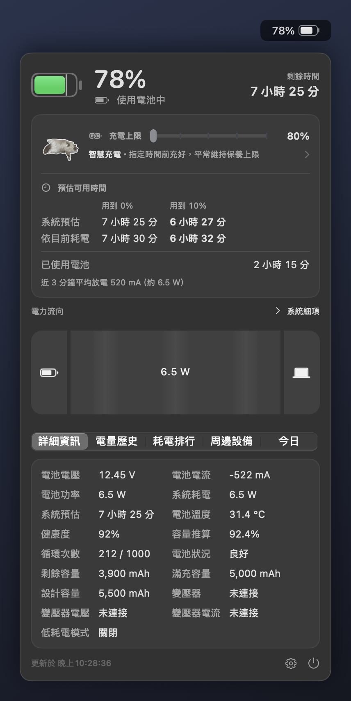
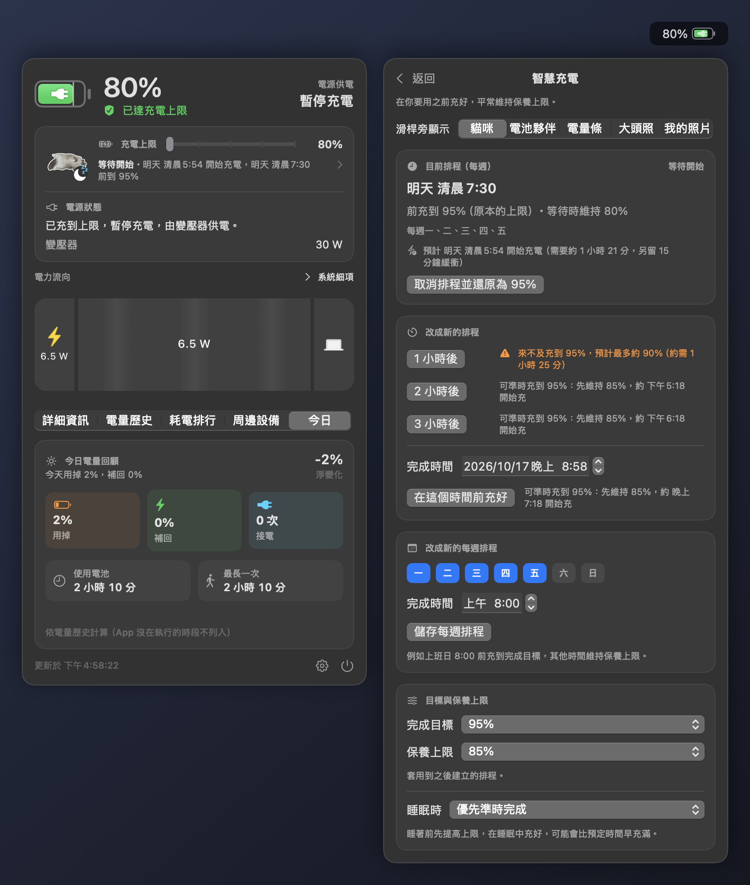
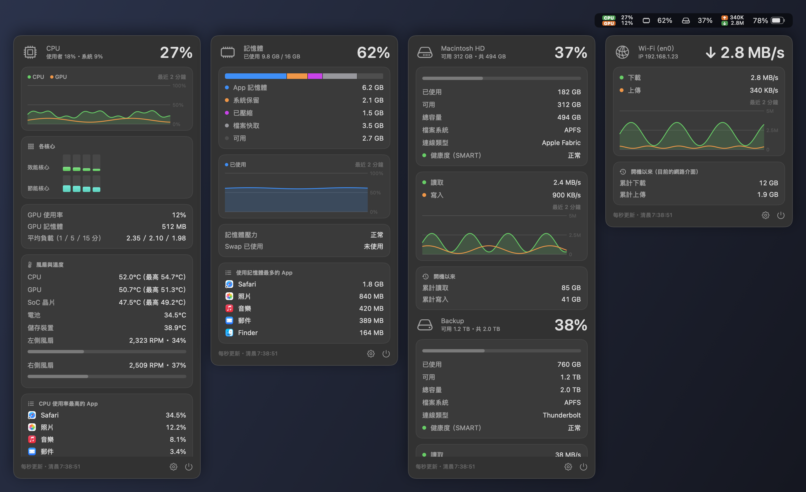
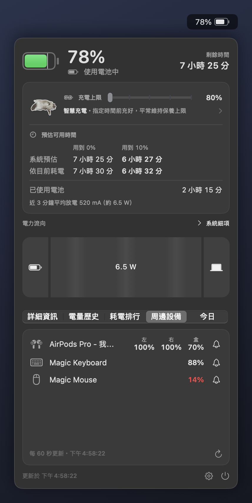
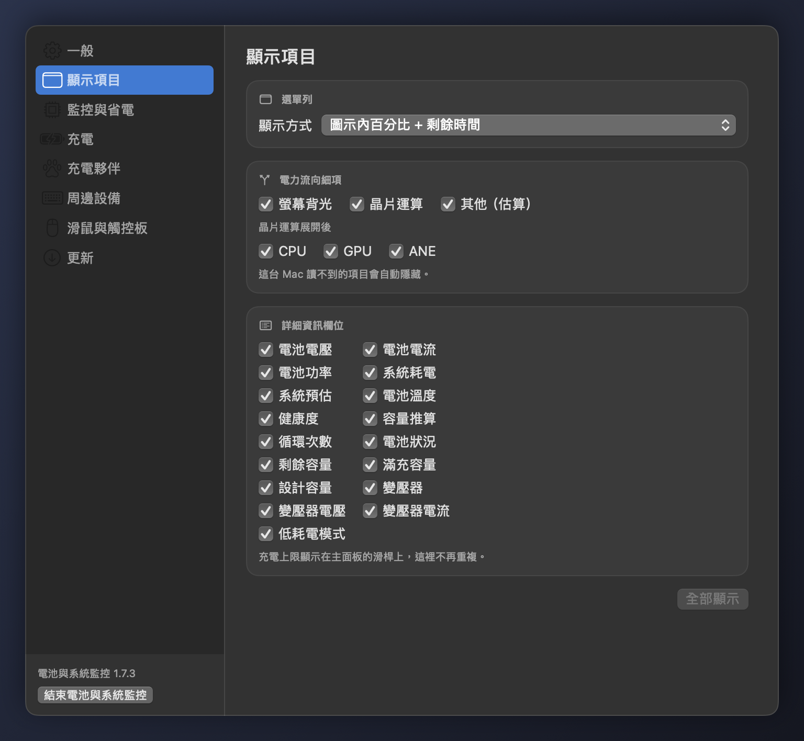
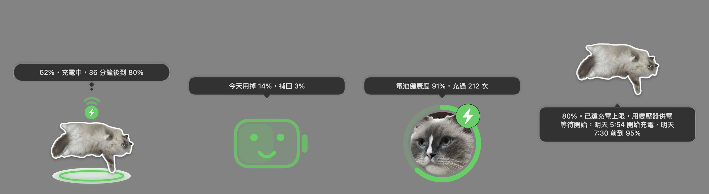
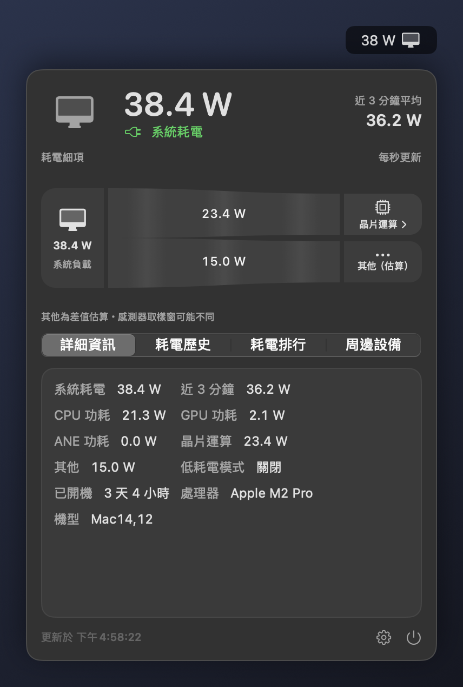
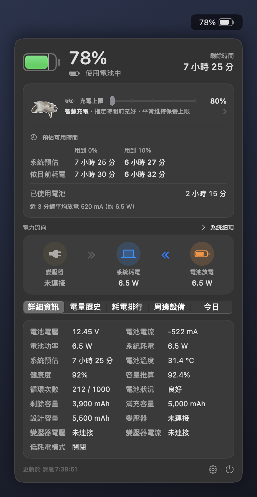

**繁體中文** | [English](README.en.md)

# 電池與系統監控 macbookBatteryMonitor

macOS 選單列的電池與系統資訊 App。MacBook 的選單列直接顯示電量，點開可以看到：
- 剩餘時間、健康度、電力流向（可展開到各硬體的耗電）；
- 充電上限滑桿、智慧充電；
- 歷史曲線、今日回顧與耗電排行；
- 藍牙鍵盤、滑鼠、耳機的電量。

桌上型 Mac（Mac mini、iMac、Mac Studio、Mac Pro）改為顯示整機耗電。CPU／GPU、記憶體、磁碟、網路的系統監控可開可關。



## 特色

- **一個 App 適用所有 Mac**：Apple 晶片與 Intel、MacBook 與桌上型都用同一個下載檔，自動判斷要顯示電池還是耗電；macOS 12、13 另有舊系統版本
- **充電上限滑桿**：在面板直接拖動 macOS 的充電上限（80–100%），和系統設定是同一個設定、兩邊同步，不需要管理員權限
- **智慧充電**：指定「幾點前充到幾 %」，平常維持保養上限，算好時間才讓 macOS 充到目標
- **電力流向**：變壓器、系統、電池之間的瓦數，可以展開到螢幕背光與 CPU／GPU／ANE
- **充電夥伴與桌面寵物**：會呼吸的貓咪、有表情的電池、電量條或一張照片，跟著充電狀態變化，也可以放到桌面上
- **周邊設備電量**：藍牙鍵盤、滑鼠、觸控板（包括羅技、Razer 等藍牙低功耗設備），AirPods 的左耳、右耳與充電盒，每個設備各自設定低電量通知
- **系統監控**：CPU／GPU（含風扇與溫度）、記憶體、磁碟（含外接磁碟與硬碟健康度）、網路，選單列各一個圖示；不用時一個開關全部關掉
- **滑鼠與觸控板分開的捲動方向**：例如觸控板維持自然捲動、滑鼠滾輪改回傳統方向
- **省電**：預設每秒更新，面板關閉時 CPU 約 0.2%；可以調慢更新頻率或開省電模式
- **一鍵更新，權限會保留**：在設定按一下就下載、驗證並換上新版；只安裝帶著發布者更新簽章、用同一張憑證簽的版本；「輔助使用」與藍牙權限不用重新允許
- **不會偷偷控制充電**：只有你拖動充電上限滑桿或設定智慧充電時，才會調整 macOS 的充電上限；實際停在上限由 macOS 控制
- **不需要 Xcode**：只要 Command Line Tools 就能編譯

## 下載

| 你的 Mac | 下載檔（最新版） |
|---|---|
| macOS 14 以上（Apple 晶片或 Intel，MacBook 或桌上型） | [`macbookBatteryMonitor.dmg`](https://github.com/sgeric910601/macbookBatteryMonitor/releases/latest/download/macbookBatteryMonitor.dmg)（通用版） |
| macOS 12 或 13（Apple 晶片或 Intel） | [`macbookBatteryMonitor-macOS12.dmg`](https://github.com/sgeric910601/macbookBatteryMonitor/releases/latest/download/macbookBatteryMonitor-macOS12.dmg)（舊系統版本） |

- 檔名固定不帶版本號，上面的連結永遠下載最新版；其他版本到 [Releases](https://github.com/sgeric910601/macbookBatteryMonitor/releases)
- 舊系統版本給 macOS 12、13 的 Mac（例如 2015～2017 年的 MacBook，或用 OpenCore Legacy Patcher 升級的舊 Mac），功能和通用版相同。系統升級到 macOS 14 以後，一鍵更新會自動換成通用版
- 已經在用 v1.5.0 以後的版本：不用下載，到設定 → 更新按「一鍵更新」
- Release 裡另外附的 zip 是給舊版一鍵更新用的，內容和 DMG 相同，不需要下載

## 安裝

1. 下載上面對應的 DMG 並打開
2. 把「電池與系統監控」拖到「應用程式」資料夾（檔名是 `macbookBatteryMonitor.app`），退出 DMG 後從「應用程式」打開。直接在 DMG 裡打開的話，App 會詢問要不要改從「應用程式」打開；還沒拖過去、或「應用程式」裡是比較舊的版本時，按一下就會幫你拷貝過去
3. 第一次打開時 macOS 會擋下來（App 沒有 Apple 開發者簽章）。任選一種方式放行：
   - 到「系統設定 → 隱私權與安全性」，在下方找到這個 App，按「強制打開」
   - 或在終端機執行：
     ```bash
     xattr -dr com.apple.quarantine /Applications/macbookBatteryMonitor.app
     ```
4. 第一次啟動時選擇：
   - 要「只看電池」還是「電池＋系統監控」（桌上型 Mac 是「只看耗電」／「耗電＋系統監控」）；
   - 要不要開啟管理員 CPU 取樣（Apple 晶片）；
   - 允許通知與藍牙（藍牙只用來讀取羅技、Razer 等藍牙滑鼠、鍵盤的電量）。

   App 會自動加入開機自啟動，可在設定關閉。

**權限會保留**：每個版本都用同一張專用憑證簽章，macOS 會把新版本當成同一個 App。「輔助使用」與藍牙權限在一鍵更新、重新安裝後都會保留，不用重新允許。這張憑證是自己建立的，不是 Apple 的開發者簽章，所以第一次打開時一樣要照上面的步驟放行。從 v1.7.3 以前的版本更新上來時換了簽章，權限要最後再允許一次：
- 藍牙會再問一次，允許即可；
- 「輔助使用」照「[捲動反向沒作用時](#捲動反向沒作用時)」的步驟。

App 名稱是「電池與系統監控」（英文系統顯示 Battery & System Monitor），設定視窗左下角顯示名稱與版本號。

## 使用方式

### 選單列

- **左鍵**點圖示打開面板，點面板以外的地方就關閉；其他 App 全螢幕（綠色按鈕）時一樣打得開。**右鍵**：打開面板、設定、結束
- **顯示方式**（設定 → 顯示項目）：圖示 + 百分比、只有圖示、只有百分比、圖示 + 剩餘時間，或圖示內百分比 + 剩餘時間（電量在電池圖示裡，右側是剩餘／充滿時間）。後者沒有時間資料時顯示「—」；滿電、接電未充電、到達上限時分別顯示「已充飽」「接電」「已達上限」
- 充電中顯示閃電、接電未充電顯示插頭，低電量變紅
- **系統監控模組**：選單列各一個圖示，左鍵打開該模組的面板，右鍵打開設定或結束；按住 ⌘ 可以拖曳調整圖示順序
- **合併成一個圖示**（設定 → 監控與省電）：選單列放不下時 macOS 會把多的圖示藏起來（有瀏海的 MacBook 特別容易），這時可以只留電池（桌上型為耗電）一個圖示。點它在選單列正下方展開第二條狀態列，列出電池與各系統監控圖示，數字即時更新；點上面的圖示打開它的面板（再點一次收起來），點其他地方或按 Esc 收起整條。系統監控只在第二條狀態列展開時取樣。不需要螢幕錄製或輔助使用權限
- 只看到電池圖示、沒有 CPU 等圖示時，先到設定 → 監控與省電確認系統監控的總開關有沒有開

### 電池面板

- **電量與時間**：電量、充放電狀態、剩餘時間或充滿時間（有充電上限時是充到上限的時間）；預估用到 0% 與用到 10% 的時間（系統預估，以及依近 3 分鐘平均耗電推算）；這次拔掉電源後已經用了多久
- **充電上限滑桿**：80–100% 每 5% 一格，放開才寫入，寫入後讀回確認系統已套用，沒套用會提示；在系統設定改的也會即時同步。拖到 100% 等於不限制。系統不支援調整充電上限的 Mac 不顯示滑桿
- **充電夥伴與智慧充電**：滑桿左邊是充電夥伴，下方是智慧充電的狀態（等待開始、充電中、已準備好等），點任一個打開智慧充電頁（見「[智慧充電](#智慧充電)」）
- **電力流向**：變壓器、系統、電池之間的瓦數。點「系統」展開成螢幕背光、晶片運算、其他（估算），點「晶片運算」再展開 CPU／GPU／ANE；機型沒有的項目自動隱藏（見「[電力流向怎麼算](#電力流向怎麼算)」）
- **詳細資訊**：電池電壓、電流、功率，系統耗電，系統預估，電池溫度，健康度、容量推算（滿充容量 ÷ 設計容量）、循環次數、電池狀況，剩餘／滿充／設計容量（mAh），低耗電模式，變壓器額定瓦數、即時電壓與電流，充電上限（有充電上限滑桿的 Mac 只顯示在滑桿上）
- **分頁**：
  - 電量歷史圖表（1 小時／24 小時／7 天；第一次啟動會用 `pmset` 的紀錄回填過去幾天）；
  - 今日回顧：今天用掉與補回的電量、淨變化、接電次數、使用電池的總時間與最長一次；
  - 耗電排行：前 5 名 App，同一個 App 的子程序合併；
  - 周邊設備。
- 電力流向的每一項、詳細資訊的每個欄位都可以在設定 → 顯示項目隱藏
- 面板比螢幕還高時（小螢幕或放大顯示）可以捲動，下方不會被切掉



### 系統監控

第一次啟動時選「電池＋系統監控」，或之後在設定 → 監控與省電打開總開關；四個模組可以各自開關。總開關關閉時完全不取樣，和只看電池一樣省電。

- **CPU／GPU**：選單列顯示 CPU 與 GPU 使用率。面板有：
  - 使用者／系統比例、最近 2 分鐘曲線、各核心（效能核心、節能核心）、GPU 記憶體、平均負載、CPU 使用率最高的 App；
  - 風扇與溫度：風扇轉速與佔最高轉速的比例（沒有風扇的機型不顯示），CPU／GPU／SoC／電池／儲存裝置溫度（讀不到的項目不顯示）。
- **記憶體**：選單列顯示使用率，記憶體壓力升高時變橘、變紅。面板有 App 記憶體、系統保留、已壓縮、檔案快取、可用的組成，最近 2 分鐘曲線、Swap 與使用記憶體最多的 App
- **磁碟**：選單列顯示開機磁碟的已使用比例。面板列出開機磁碟與目前掛載的外接磁碟（USB、Thunderbolt、SD 卡，不含映像檔與網路磁碟），每顆有已使用／可用容量、檔案系統、連線類型、健康度、讀寫速度與曲線、累計讀寫
  - NVMe 硬碟會自己記錄已用掉的設計壽命與出廠以來的讀寫總量。Apple 晶片 Mac 的內建硬碟都是 NVMe，多數 2016 年以後的 Intel Mac 與 Thunderbolt 外接盒也是。健康度是 100% 減去已用壽命（已用 3% 就是 97%），累計讀寫是這顆硬碟出廠以來的總量，另外列出通電時間，有媒體錯誤時多一行。硬碟回報嚴重警告或備用區塊低於門檻時，顯示紅色的「異常，建議立即備份」
  - 讀不到的硬碟（不是 NVMe 的內建硬碟，例如 2015 年的 MacBook Air；多數 USB 外接盒）顯示 SMART 的「正常／異常」，累計讀寫是開機（外接磁碟是接上）以來的量
- **網路**：選單列顯示上傳與下載速度；面板有目前的網路介面（Wi-Fi、乙太網路）與 IP、速度曲線、開機以來的累計流量
- 同一個 App 的子程序（例如瀏覽器分頁）會合併到 App 名下



### 周邊設備

面板下方的「周邊設備」分頁列出連線中的藍牙鍵盤、滑鼠、觸控板與耳機電量：
- AirPods 等耳機在同一行並排顯示「左」「右」「盒」三個電量；
- 羅技、Razer 等非 Apple 的藍牙低功耗滑鼠、鍵盤也會顯示（需要允許藍牙權限）。

每個設備右邊的鈴鐺可以設定低電量通知：不通知，或低於 10%、15%、20%、30%、50% 時通知（預設 20%）。設定 → 周邊設備可以一次設定所有連線中的設備。電量每 60 秒更新，右下角的箭頭可以立即更新。



### 通知

- **低電量、充電完成**：門檻可調，到達系統充電上限也會通知。接著電源但電池仍在放電時（充電器瓦數不足或負載太重），低電量提醒照樣會響
- **智慧充電**：在完成時間前充好，或照目前速度可能趕不上時，各通知一次
- **周邊設備**：每個設備降到自己的門檻時通知一次，充電回到門檻以上才會再通知
- **新版本**：見「[一鍵更新](#一鍵更新)」
- macOS 關閉了這個 App 的通知時，設定 → 一般的「通知」會提醒，並可以直接打開系統設定的通知頁

### 設定視窗

點面板右下角的齒輪，或選單列圖示右鍵的「設定…」。開著時 App 會暫時出現在 Dock 與 ⌘Tab，切到系統設定再回來也找得到，⌘W 關閉。左邊的分類：

| 分類 | 內容 |
|---|---|
| 一般 | App 圖示顏色、通知門檻、開機自啟動 |
| 顯示項目 | 選單列顯示方式、電力流向細項、詳細資訊欄位 |
| 監控與省電 | 更新頻率、省電模式、系統監控總開關與各模組、合併成一個圖示、管理員 CPU 取樣 |
| 充電 | 充電上限滑桿、智慧充電 |
| 充電夥伴 | 外觀、我的照片、桌面寵物的位置、大小與會動的眼睛 |
| 周邊設備 | 各設備的低電量通知 |
| 滑鼠與觸控板 | 分開的捲動方向 |
| 更新 | 一鍵更新、自動檢查與新版本通知 |

桌上型 Mac 沒有「充電」與「充電夥伴」。面板上的齒輪打開上次看的分類，「有新版本」打開「更新」，系統監控面板的齒輪打開「監控與省電」。



## 智慧充電

需要能從 App 調整充電上限的 Mac：Apple 晶片的 MacBook，系統設定 → 電池裡有「充電上限」。不支援的 Mac 沒有智慧充電，面板上方只顯示充電夥伴。

**怎麼用**：點充電上限滑桿左邊的充電夥伴、滑桿下方的狀態，或打開設定 → 充電。可以選：
- 「1 小時後」「2 小時後」「3 小時後」；
- 指定完成時間；
- 勾選星期與時間，存成每週排程（例如上班日 8:00）。

按之前，每個選項旁邊就會依目前電量與充電速度預估：
- 來得及：顯示「可準時充到 95%：先維持 80%，約 8:07 開始充」；
- 電量已接近目標：顯示「會直接充到 95%」；
- 來不及：顯示「來不及充到 100%，預計最多約 90%」。

**怎麼運作**

1. 等待期間，App 把 macOS 的充電上限設成「保養上限」（預設 80%）。電量已經高於保養上限時，不會把上限降到電量以下（那樣 macOS 會先放電到保養上限再充回來，白白多一次充放電），而是維持在目前的電量（進位到 5% 一格，例如 93% 時維持 95%）
2. 依需要的充電時間往前推算開始時間：有正在充電的速度就用它，沒有就用最近七天實際充電速度的中位數，再沒有就以每小時 20% 估算；80% 以上充電會變慢，這一段的時間乘上 1.8，另外預留 15 分鐘緩衝
3. 到了開始時間，把充電上限提高到「完成目標」，由 macOS 自己充電。完成目標預設是「原本的上限」（建立排程時系統設定的充電上限），需要 100% 時另外選。開始之後即使估算的時間變短，也不會把上限降回去，避免充到一半停下來
4. 充好時發一則「已充到目標」的通知。一次性的排程在拔掉電源後還原原本的充電上限（完成時間過了 2 小時還沒拔也會還原），每週排程則換到下一次
5. 照目前速度趕不上完成時間時，狀態顯示「可能無法準時」並通知一次，仍會繼續充電

完成目標與保養上限在智慧充電頁的「目標與保養上限」設定，套用到之後建立的排程。

- **你自己調整時以你為準**：排程進行中，你在面板拖動充電上限滑桿或在系統設定改了上限，App 就結束排程，不會改回去，也不會還原。按智慧充電頁的「取消排程並還原」，則會還原成建立排程前的上限
- **每次寫入都會確認**：寫入後讀回系統的上限，等於目標才算成功；失敗時 1 分鐘後重試，還原失敗也會保留排程、稍後再試

**睡眠時**（智慧充電頁的「睡眠時」）

- **優先準時完成**（預設）：Mac 睡著時 App 無法準時提高上限，所以睡眠前若還在等待，會先把上限提高到目標，讓 macOS 在睡眠中充好（可能比預定時間早充滿）；醒來時如果還沒到開始時間，再降回保養上限。睡眠前最多等 5 秒讓寫入完成
- **精準喚醒**：在該開始充電前 1 分鐘叫醒 Mac，醒來就把上限提高到目標，等待期間一直維持保養上限。只有還在等待時才排喚醒，已經充好或沒接電源時不會白白叫醒 Mac。需要管理員授權一次，安裝和「管理員 CPU 取樣」共用的系統服務。喚醒事件的識別碼固定是 `com.kuan.batterymonitor.charging`（`pmset -g sched` 看得到），服務只接受 1 分鐘後到 7 天內的一個時間。授權取消或服務無法使用時，自動改回「優先準時完成」

**限制**：實際充電仍由 macOS 控制，溫度保護、「最佳化電池充電」等系統機制可能讓充電暫停（狀態顯示「macOS 暫停充電」），不保證一定準時充滿。

**紀錄**：狀態變化、寫入上限與系統讀回的結果、睡眠與喚醒、喚醒排程都記在 `~/Library/Logs/macbookBatteryMonitor/charging-plan.log`，只存在這台 Mac，超過 256 KB 只留後半。`macbookBatteryMonitor --charging-plan-status` 會印出目前的排程、系統充電上限、電量、排定的喚醒事件與最近的紀錄，不改動任何設定。

## 充電夥伴

智慧充電頁最上方的「滑桿旁顯示」，或設定 → 充電夥伴的「外觀」，可以在五種外觀之間切換；不能調整充電上限的 Mac 叫「面板上方顯示」。接著電源但沒在充（到達充電上限、充滿）時，每種外觀都變成綠色，右上角有插頭標示。

- **貓咪（預設）**：6 秒循環的透明背景動畫，肚子呼吸起伏，尾巴偶爾慢慢掃一下，垂下的前腳偶爾晃一下。充電時躺在發光的充電墊上、上方有充電波紋；等待時旁邊有睡覺的標示，充好時有打勾，到達充電上限時有插頭。面板開著時播放，面板關閉或省電模式時顯示靜態圖
- **電池夥伴**：有表情的電池，裡面的底色是目前的電量。沒有排程時面無表情，等待時閉眼睡覺，充電中微笑，充好或到達充電上限時大笑，可能延遲或系統暫停時皺眉，面板開著時偶爾眨眼
- **電力流動**：電量條，充電中有光點往右流，到達充電上限時是綠色的插頭
- **貓咪大頭照**：內建的布偶貓照片，裁成圓形，外圈是電量環（顏色跟著狀態），右上角是狀態標示；當桌面寵物時眼睛會動
- **我的照片**：自己選的照片，在設定 → 充電夥伴的「選擇照片…」（或智慧充電頁、桌面寵物右鍵的「換照片…」）選好就改用這個外觀，貓咪大頭照照樣保留，隨時可以換回來。照片從中間裁成正方形、縮成 256 像素重新存檔（不留拍攝地點等照片資訊），只存在這台 Mac 的 `~/Library/Application Support/BatteryMonitor/`；按「移除」就刪掉

## 桌面寵物

MacBook 上，到設定 → 充電夥伴打開「在桌面顯示」，充電夥伴就會出現在桌面上（預設在右下角），大小和日曆小工具差不多。



- **外觀**：和面板裡選的一樣，一直會動，只有省電模式時是靜態圖。貓咪用高解析度的動畫，充電時腳下是發光的充電墊、頭上是充電標示
- **滑鼠移過去**：出現想像框，顯示電量與狀態（例如「62%・充電中，36 分鐘後到 80%」「78%・還能用 7 小時 25 分」），有智慧充電排程時再加一行
- **點一下**：出現對話框說一句話，每點一次換一句：心情（快沒電、充電中、吃飽了、等待智慧充電時在睡覺）、今天用掉與補回的電量、電池健康度與循環次數、整台 Mac 現在的耗電；4 秒後收起來
- **連點兩下**打開面板；**右鍵**可以打開面板、換外觀、換照片、換大小、切換位置、打開充電夥伴的設定或隱藏
- **拖曳**：可以放在螢幕上任何地方，包括選單列旁邊、Dock 上方，也可以一部分超出螢幕（至少留一角在螢幕上，找得回來），位置會記住。拖到螢幕頂端時不會被 macOS 當成視窗並排、放大到中間
- **大小**：50%～200%，用設定 → 充電夥伴的滑桿或右鍵的「大小」（小、標準、大、特大）調整；改大小時腳底的位置不動
- **會動的眼睛**（貓咪大頭照）：眼睛跟著滑鼠游標轉，偶爾眨眼；等智慧充電時閉眼睡覺，滑鼠移過去就醒來。用的是照片裡貓咪自己的虹膜，只移動眼睛那一小塊，滑鼠不動時不用 CPU（M1 實測滑鼠一直移動時約多 0.4% CPU）。打開「在桌面顯示」、外觀是貓咪大頭照時，設定 → 充電夥伴有「眼睛跟著游標」（關掉就完全不監聽滑鼠移動）與「會眨眼、睡覺」兩個開關。「我的照片」的眼睛不會動
- **摸摸**：滑鼠在寵物身上左右來回移動幾下，頭上冒出愛心，說「呼嚕呼嚕～」「好舒服喔」等
- **位置**：「浮在視窗上方」或「放在桌布上」（和桌面圖示同一層，會被視窗蓋住）。每個桌面都看得到，全螢幕的 App 裡不出現
- 對話框是另一個不接收滑鼠的視窗，緊貼在寵物旁邊（上方空間不夠就放下方），不會擋到下面的東西

## 滑鼠與觸控板的捲動方向

macOS 的「自然捲動」是滑鼠和觸控板共用一個設定：觸控板習慣自然捲動的人，接上滑鼠後滾輪方向也會跟著反過來。設定 → 滑鼠與觸控板可以分開設定：

- **滑鼠滾輪反向**：一般滑鼠滾輪與 Magic Mouse 反過來
- **觸控板反向**：只反轉觸控板
- **怎麼分辨**：兩指以上在觸控板上捲動算觸控板，放開手指後的慣性也算；其他（一般滾輪、Magic Mouse 的單指捲動）算滑鼠。垂直與水平捲動一起反向。觸控板的慣性還在滑時轉一下滾輪，滾輪照滑鼠的設定，之後的慣性仍照觸控板的設定
- **網頁不會往回彈**：反向的觸控板與 Magic Mouse 捲動改用新造的事件取代，網頁拿來算慣性的原始捲動量也一起反向
- **權限**：需要「輔助使用」。打開開關時 macOS 會請你到「系統設定 → 隱私權與安全性 → 輔助使用」打開「電池與系統監控」，允許後幾秒內就生效，不用重開 App；之後更新或重新安裝都會保留
- **狀態**：設定頁顯示實際情況，「運作中」表示正在攔截，「啟動中…」表示有權限、馬上會開始；沒有權限時顯示橘色的提醒與「打開輔助使用設定」
- **耗電與穩定**：兩個開關都關掉時完全不攔截；打開時只在捲動的瞬間處理事件。攔截在自己的高優先執行緒上跑，每 5 秒檢查一次，被系統暫停就重新打開、失效就重建

運作方式的細節見 [docs/design/scroll-direction.md](docs/design/scroll-direction.md)。

### 捲動反向沒作用時

通常是從 v1.7.3 以前的版本更新上來：清單裡的「電池與系統監控」是舊版本的允許，開關看起來開著，對新版本卻沒有作用。重新允許一次：

1. 打開 App 的 設定 → 滑鼠與觸控板，下方會顯示橘色的「需要允許『輔助使用』」，按「打開輔助使用設定」
2. 在清單裡選「電池與系統監控」，按下方的「－」移除（開關看起來還開著也要移除）
3. 按「＋」，到「應用程式」選 `macbookBatteryMonitor`，按「打開」，確認它的開關是打開的
4. 回到 App 的設定頁，幾秒內狀態變成「運作中」就恢復了，不用重開 App

## App 圖示

圖示是一隻仰躺在無線充電墊上的布偶貓（照片去背）。設定 → 一般可以換背景色：薄荷綠（內建）、暖杏色、深夜藍、天空藍。


- 換的是「應用程式」資料夾、Finder、Launchpad、Spotlight 裡看到的圖示，等同在「取得資訊」裡貼上自訂圖示；通知與系統設定的登入項目用的是內建圖示，仍是薄荷綠
- 換成其他顏色時，App 最上層會多一個自訂圖示檔，`codesign --verify --strict` 會回報有多餘的檔案；App 照常執行，權限也不受影響，換回薄荷綠就會移除
- 一鍵更新或用新版覆蓋後，App 啟動時會自動套回你選的顏色

## 一鍵更新

設定 → 更新可以檢查 GitHub 上的新版本，有新版時按「一鍵更新」：

1. 下載 DMG（舊系統版本下載 `macbookBatteryMonitor-macOS12.dmg`，系統已是 macOS 14 以上時改下載通用版）。只從 `github.com` 與 `githubusercontent.com` 下載
2. 驗證（任何一項不符就取消更新）：
   - Release 附的校驗檔 `SHA256SUMS.txt` 要帶著發布者的更新簽章 `SHA256SUMS.sig`（Ed25519）。簽章的私鑰只在發布者的 Mac 上，不在 GitHub，所以就算有人能上傳檔案到 GitHub 也做不出能安裝的版本
   - 用簽過的校驗檔核對 DMG
   - 取出的 App 要是同一張憑證「macbookBatteryMonitor Signing」簽的，識別碼、版本號與 Beta 序號也要對
   - DMG 在暫存資料夾唯讀掛載，不會出現在 Finder 或桌面
3. App 結束後換上新版並重新開啟，換不過去會放回原本的版本。設定、電量歷史、智慧充電排程與 App 圖示顏色都會保留；下載或驗證失敗、更新中途被中斷時，暫存檔會清掉

- **自動檢查更新**（預設開啟）：啟動後與之後每 6 小時看一次，距離上次檢查超過一天才連到 `api.github.com`；只提示，不會自動安裝。新版發布後大約 1 天內會發現
- **有新版本時通知**（預設開啟）：自動檢查發現新的正式版時發一則通知，每個版本只通知一次；點通知或面板底部的「有新版本」打開設定的「更新」
- **Beta 測試版**：GitHub 上標成「預先發行版本」的 Beta（例如 v1.8.0-beta.1）只有按「檢查更新」時才會列出，自動檢查不提示、也不發通知。按「安裝 Beta…」後會先說明測試版可能不穩定，再按一次「安裝 Beta」才會安裝。已有比 Beta 新的正式版時只列出正式版。想回到正式版，到 GitHub 下載正式版重新安裝即可
- 沒有更新簽章的 Release 不會提示，也不會安裝（v1.7.5 起；v1.7.4 以前的版本只核對校驗檔與簽章是否完好）
- **從 DMG 打開，或被 macOS 搬到暫存位置執行時**，一鍵更新會更新「應用程式」裡的那一份，裝好後從那裡打開（v1.7.6 起）。被搬到暫存位置，是指 App 帶著從網路下載的隔離標記、又沒有用 Finder 搬過（例如用指令複製），macOS 每次都把它放在隨機的唯讀位置執行，重新開機也一樣。這時啟動時會詢問要不要改從「應用程式」打開：按下去會確認那一份是同一張憑證簽的、清掉它的隔離標記再重新打開，只需要做一次；macOS 可能會再請你按一次「強制打開」。以前的版本遇到這種情況只能手動下載，或執行 `xattr -dr com.apple.quarantine /Applications/macbookBatteryMonitor.app`
- App 不在可寫入的位置（例如由系統管理員安裝）時無法一鍵更新，會提示到 GitHub 手動下載

**舊版本怎麼更新上來**：
- 每個 Release 都附上舊版一鍵更新認得的檔案；
- v1.5.0 以後的版本都能直接一鍵更新到最新版，只有 v1.7.1 的舊系統版本要先經過過渡版 v1.7.2；
- v1.4.1 以前沒有一鍵更新，要手動下載一次。

## 桌上型 Mac

沒有電池的 Mac 選單列顯示電腦圖示與整機耗電瓦數。面板有：
- 整機耗電與近 3 分鐘平均；
- 耗電細項：晶片運算、CPU／GPU／ANE、其他；
- 耗電歷史、耗電排行與周邊設備。

設定視窗沒有「充電」「充電夥伴」，也沒有電池相關的通知。

App 看三件事判斷是不是桌上型：
1. 產品名稱，例如「Mac mini (M1, 2020)」；
2. 電池有沒有裝著；
3. 系統的電源清單裡有沒有內建電池。

Apple 晶片的桌上型 Mac 系統裡也有一個空的電池元件，v1.7.3 以前會把 M1 Mac mini 當成筆電、顯示電量 0%。



## Intel Mac

通用版需要 macOS 14 以上，大約是 2018 年以後的機型；更舊的用舊系統版本。在 2018 Mac mini（Intel Core i5-8500B、macOS 15）與 2015 MacBook Air（macOS 13，舊系統版本）實測：

- **電池**：電量、電壓、電流、循環次數與容量和 `pmset`、`ioreg` 一致；2015 MacBook Air 的 macOS 沒有提供健康度（最大容量）與變壓器即時電壓、電流，顯示「—」，可以參考容量推算
- **溫度**：CPU 用各核心的 SMC 溫度鍵（`TC1C` 起，沒有的核心回報 -127 會被過濾），讀不到時改用 PECI／die／proximity（`TCXC`、`TC0F`、`TC0P`）；內顯 `TCGC`、獨立顯卡 `TG0D`／`TG0P`；SSD `TH0a`／`TH0b`；MacBook 電池 `TB0T` 系列
- **CPU／內顯功耗**：SMC 的 `PCPC`／`PCPG`，不需要管理員密碼，所以 Intel 沒有「管理員 CPU 取樣」
- **GPU 記憶體**：Intel 內顯讀 `inUseSysMemoryBytes`，負載時偶爾出現的溢位值（超過實體記憶體）會丟掉
- Intel 不支援從 App 調整充電上限，所以沒有充電上限滑桿與智慧充電；面板上方一樣有充電夥伴，點一下可以換外觀
- 舊的 Intel Mac 沒有 HEVC 硬體解碼，充電夥伴的動畫一樣會動

## 管理員 CPU 取樣

選用，預設關閉。部分 Apple 晶片（例如 M1、M2 Pro）的 CPU 能量計數不更新，晶片細項的 CPU 只能顯示 0 W。需要 CPU 功耗時，可以在設定 → 監控與省電的「CPU 功耗」打開「管理員 CPU 取樣」，改用系統內建的 `powermetrics` 讀取。

- **開啟**：只有在設定裡親手打開時才會跳出 macOS 的管理員授權視窗，安裝一個系統服務；不儲存密碼、不修改 sudoers。授權取消或失敗時選項自動關回去，開 App 或開機時不會跳出密碼視窗
- **取樣**：只在主面板開著時連線，間隔和其他資訊相同。關閉面板、換到智慧充電頁、睡眠或結束 App 就斷線，`powermetrics` 立即停止；服務閒置 30 秒後自行結束，不常駐
- **耗電**：M1 MacBook Air 實測，面板開著時服務與 `powermetrics` 合計另佔 CPU 約 1%（省電模式約 0.3%）；面板關閉時和沒開這個選項相同
- **安全**：服務只接受安裝時那位使用者的連線，只能開始／停止固定參數的 `powermetrics`（間隔只能是 1、2、5、10 秒）、排定或取消一個固定識別碼且限定時間範圍的智慧充電喚醒，或移除自己；不接受任意指令、路徑或 PID
- **關閉**：關掉選項就停止並移除服務（不需要密碼）；智慧充電的精準喚醒也在使用時只斷線，兩個都關掉才移除
- **位置**：服務程式在 `/Library/PrivilegedHelperTools/com.kuan.batterymonitor.cpu/`，啟動設定在 `/Library/LaunchDaemons/com.kuan.batterymonitor.cpu.plist`

## 電力流向怎麼算

- **變壓器輸入**讀 SMC `PDTR`，**系統耗電**讀 SMC `PSTR`，**電池功率**是兩者相減，三個數字一定對得起來；缺少任一路時改用電池晶片的電壓 × 電流
- **是否在充電**以 SMC 的即時功率為主：電池晶片的「充電中」旗標常停在舊值，只在功率模糊時參考
- **顯示穩定**：接著電源時，充電中／已達上限／未充電之間的切換要持續 10 秒才更新，避免 macOS 在上限附近反覆暫停、恢復充電時圖示跟著跳；實際插拔電源立即更新。剛插電 30 秒內先不畫電池供電（Intel 的充電器要十幾秒才開始充）
- **時間預估**：macOS 還在估算時顯示「計算中…」，不自己用直線推算（沒考慮 80% 以上電流變小）；有充電上限時，右上角與詳細資訊都是充到上限的時間
- **硬體細項**：螢幕背光讀 SMC `PDBR`／`PBwo`；CPU／GPU／ANE 在 Apple 晶片上讀 IOReport 的能量模型，在 Intel 上讀 SMC `PCPC`／`PCPG`；「其他」是系統總功耗扣掉背光與晶片的差值估算。缺細項或取樣不同步時不硬算，改標「資料不完整」或「取樣不同步」
- 晶片合計只涵蓋取得的 CPU、GPU、ANE，不代表完整 SoC 功耗，也不含外接螢幕。IOReport 是系統私有介面，可用性依晶片與 macOS 版本而異

| 機型 | 系統總功耗 | 背光 | GPU | CPU | ANE |
|---|---|---|---|---|---|
| M2 Pro | ✓ | ✓ | ✓ | 顯示 0 W（計數不更新）；開啟管理員 CPU 取樣可讀到 | 閒置時 0 W |
| M1 MacBook Air | ✓ | 沒有感測器，算在「其他（含螢幕）」 | ✓ | 顯示 0 W（計數不更新）；開啟管理員 CPU 取樣可讀到 | 沒有通道，自動隱藏 |

取樣時間怎麼對齊、什麼情況不顯示「其他」，見 [docs/design/hardware-power-flow.md](docs/design/hardware-power-flow.md)。

## 效能與省電

所有即時資訊預設每 1 秒更新，可以在設定 → 監控與省電改成每 2、5、10 秒，越慢越省電。**省電模式**：電力流向改用靜態圖示與箭頭，充電夥伴與流向都不播動畫，更新頻率至少每 2 秒；可以勾選「只在使用電池時啟用」，接上電源時自動恢復。



M1 MacBook Air 實測 CPU 使用率：

| 情況 | 每秒更新 | 省電模式（每 2 秒） |
|---|---|---|
| 面板關閉，只看電池 | 約 0.2% | 約 0.15% |
| 面板關閉，四個系統監控模組全開 | 約 1% | 約 0.5% |
| 打開電池面板（耗電排行分頁） | 約 4%，`top` 另佔約 6% | 約 2%，`top` 另佔約 3% |
| 打開 CPU 或記憶體模組面板 | 約 3%，`top` 另佔約 6% | 約 2%，`top` 另佔約 3% |

- 面板關著時只讀選單列需要的資料（電量、狀態、功率、剩餘時間）；插拔電源由系統通知立即更新。選單列圖示只有在數字、時間或狀態改變時才重畫
- 面板每次打開才建立，關閉就整個釋放，背景沒有畫面在更新。硬體細項、SMC 溫度與選用的管理員 CPU 取樣只在面板開著時讀
- `top` 只在耗電排行分頁或 CPU／記憶體面板開著時執行
- SMC 每個 key 的格式查過一次就記住；每秒只讀 `PDTR`、`PSTR` 兩個值。變壓器規格接上電源後每 30 秒查一次；系統的充電上限只在啟動、打開面板與系統通知有變更時讀
- 智慧充電沒有排程時不做任何事；需要改上限時才呼叫系統
- 流向與電量條的動畫由 Core Animation 合成，不逐幀更新畫面；充電夥伴是小尺寸的透明 HEVC 影片，第一次顯示時解碼一次，之後逐格播放（M1 實測桌面寵物一直動只多約 0.2% CPU、約 16 MB 記憶體）
- 系統監控只取樣有開啟的模組；總開關關閉時完全不建立模組的圖示與計時器
- 磁碟容量每秒用 `statfs()` 讀，系統可清出的空間每 5 分鐘校正一次；外接磁碟清單不會被離線的網路磁碟卡住。硬碟健康度只在磁碟面板開著時讀（一次約 0.2 毫秒）；讀不到時改查 SMART 狀態，要啟動 `diskutil`、可能喚醒休眠中的外接硬碟，所以每顆最多 10 分鐘一次
- 風扇與溫度只在 CPU 面板開著時於背景每 2 秒讀一次
- 周邊設備每 60 秒查一次；耳機要跑 `system_profiler`，所以背景更新時只有連著藍牙音訊裝置才查；藍牙低功耗設備只向已連線的設備讀電量，不建立新連線
- 電量歷史每分鐘記一筆，每 15 分鐘寫一次檔，睡眠前和結束時也會存；健康度每 6 小時查一次

> 截圖為示範數據。

## 資料來源

| 項目 | 來源 |
|---|---|
| 電量、電壓、原始電流、容量、循環次數 | IORegistry `AppleSmartBattery` |
| 變壓器輸入、系統功耗、背光 | SMC（唯讀，`PDTR`、`PSTR`、`PDBR`／`PBwo`）；桌上型 Mac 只讀 `PSTR` |
| 變壓器即時電壓、電流 | SMC（唯讀，`VD0R`、`ID0R`）；沒有時用 IORegistry `PowerTelemetryData` 的 `SystemCurrentIn` |
| 電池功率 | 「變壓器輸入 − 系統功耗」；缺少任一路時用 IORegistry 的電壓 × 電流（不使用 `PPBR`） |
| CPU／GPU／ANE 功耗 | Apple 晶片：IOReport 能量模型，管理員 CPU 取樣改用 `powermetrics`；Intel：SMC `PCPC`／`PCPG` |
| 系統預估時間、是否接著電源 | IOKit Power Sources |
| 是否在充電 | SMC 即時電池功率為主，數值模糊時看電池晶片的充電旗標 |
| 健康度（最大容量）、電池狀況 | `system_profiler SPPowerDataType` |
| 電池溫度 | IORegistry `AppleSmartBattery` 的 `Temperature`（沒有時用 `VirtualTemperature`），都沒有時讀 SMC（唯讀，`TB0T`～`TB2T`） |
| 耗電排行 | `top -o power` |
| 歷史回填、拔電時間 | 電量歷史與 `pmset -g log`；拔電時間早於這次開機時從開機時間算起 |
| 是不是桌上型 Mac | IORegistry 的產品名稱與 `AppleSmartBattery` 的 `BatteryInstalled`、IOKit Power Sources 的內建電池 |
| 充電上限（設定與調整） | macOS 的充電上限服務（PowerUI 的 `PowerUISmartChargeClient`，系統設定的電池頁也是用它），變更通知 `com.apple.powerui.mclstatuschanged`；不需要管理員權限 |
| 充電上限（目前生效中） | `/Library/Preferences/com.apple.powerd.charging.plist`（唯讀，只在接電時存在） |
| 智慧充電的充電速度 | 正在充電時的平均電流；沒有時用最近七天電量歷史的充電速度中位數 |
| 智慧充電的精準喚醒 | 管理員服務以 IOKit `IOPMSchedulePowerEvent` 排定 `wake` 事件 |
| 睡眠前的寫入 | IOKit 系統電源通知（`IORegisterForSystemPower`），最多延後睡眠 5 秒 |
| 今日回顧 | 電量歷史（每分鐘一筆） |
| CPU 使用率、各核心 | `host_processor_info` 的累計 tick 差值；核心類型來自 `hw.perflevel0／1` |
| 平均負載 | `getloadavg` |
| GPU 使用率、GPU 記憶體 | IORegistry `IOAccelerator` 的 `PerformanceStatistics`（Intel 內顯的記憶體是 `inUseSysMemoryBytes`） |
| 記憶體組成、壓力、Swap | `host_statistics64`、`kern.memorystatus_vm_pressure_level`、`vm.swapusage` |
| 磁碟容量 | `statfs()`，加上定期校正的系統可清出空間（與 Finder 一致） |
| 磁碟讀寫 | IORegistry `IOBlockStorageDriver` 的累計讀寫位元組 |
| 外接磁碟清單、連線類型 | `getfsstat(MNT_NOWAIT)`、DiskArbitration（`DeviceInternal`、`DeviceProtocol`） |
| 硬碟健康度、出廠以來的讀寫量、通電時間 | NVMe 的 SMART／健康資訊記錄（系統內建的 NVMeSMARTLib 外掛，不需要管理員權限）：100% 減去 Percentage Used、Data Units Read／Written（每單位 512,000 位元組）、Power On Hours |
| 硬碟健康狀態（讀不到上一列時） | `diskutil info -plist` 的 `SMARTStatus` |
| 風扇轉速 | SMC（唯讀，`F<n>Ac`、`F<n>Mn`、`F<n>Mx`） |
| CPU 面板的溫度 | IOHIDEventSystem 溫度感測器（私有介面，不存在時不顯示）；M2 系列改讀 SMC 核心溫度鍵；Intel 見「Intel Mac」 |
| 網路速度與累計流量 | `sysctl` 的 64 位元介面計數器（`NET_RT_IFLIST2`），只查目前使用中的介面 |
| 網路介面與 IP | `SCDynamicStore`（預設路由介面）、`getifaddrs` |
| CPU／記憶體 App 排行 | `top -o cpu`、`top -o mem` |
| 周邊設備電量（鍵盤、滑鼠、觸控板） | IORegistry 中帶 `BatteryPercent` 的服務 |
| 周邊設備電量（藍牙低功耗滑鼠、鍵盤） | CoreBluetooth：已連線設備的標準電池服務（`0x180F`）的電池電量（`0x2A19`），需要藍牙權限；名稱看不出是滑鼠或鍵盤時用 IORegistry 的 HID 用途判斷 |
| 周邊設備電量（耳機左右耳、充電盒） | `system_profiler SPBluetoothDataType`；是否連著藍牙耳機由 CoreAudio 的裝置清單判斷 |
| 捲動方向（選用） | `CGEvent` 事件攔截（捲動與觸控板手指事件），需要「輔助使用」權限；兩個開關都關掉時不攔截 |
| 會動的眼睛 | `NSEvent` 的滑鼠移動事件（只讀游標位置，不需要權限）；只在桌面寵物是貓咪大頭照、而且「眼睛跟著游標」打開時監聽 |
| 新版本資訊 | GitHub API `releases`（最近 20 個），自動檢查每天最多一次；下載檔以 Release 的 `SHA256SUMS.txt` 驗證，校驗檔以 `SHA256SUMS.sig`（Ed25519，CryptoKit）驗證，App 以 `codesign` 確認是同一張憑證簽的 |

## 資料存放位置

- 電量歷史：`~/Library/Application Support/BatteryMonitor/history.json`（保留 7 天）
- 我的照片：`~/Library/Application Support/BatteryMonitor/`
- 設定與智慧充電排程：`com.kuan.batterymonitor`（UserDefaults）
- 智慧充電紀錄：`~/Library/Logs/macbookBatteryMonitor/charging-plan.log`
- 管理員服務（只在開啟管理員 CPU 取樣或精準喚醒時存在）：`/Library/PrivilegedHelperTools/com.kuan.batterymonitor.cpu/`、`/Library/LaunchDaemons/com.kuan.batterymonitor.cpu.plist`

## 解除安裝

1. 有設定智慧充電的話，先在智慧充電頁按「取消排程並還原」，把充電上限還原
2. 在設定裡關閉「管理員 CPU 取樣」、把智慧充電的「睡眠時」改回「優先準時完成」（有開過的話會移除系統服務），關閉「開機時自動啟動」，然後結束 App。開過捲動方向的話，到「系統設定 → 隱私權與安全性 → 輔助使用」移除這個 App
3. 刪除 `/Applications/macbookBatteryMonitor.app`
4. 如果先刪了 App、系統服務還留著，在終端機執行：
   ```bash
   sudo launchctl bootout system/com.kuan.batterymonitor.cpu
   sudo rm -f /Library/LaunchDaemons/com.kuan.batterymonitor.cpu.plist
   sudo rm -rf /Library/PrivilegedHelperTools/com.kuan.batterymonitor.cpu
   ```
5. （選擇性）清除資料：
   ```bash
   rm -rf ~/Library/Application\ Support/BatteryMonitor ~/Library/Logs/macbookBatteryMonitor
   defaults delete com.kuan.batterymonitor
   ```

## 舊版本

舊版本保留在 [Releases](https://github.com/sgeric910601/macbookBatteryMonitor/releases)，但都有已知問題，最新版已經全部修正。v1.5.0 以後的版本可以直接一鍵更新到最新版。想省電的話，請用最新版的「只看電池」，再開省電模式或調慢更新頻率，不要改用舊版。

| 版本 | 主要新增 |
|---|---|
| [v1.7.3](https://github.com/sgeric910601/macbookBatteryMonitor/releases/tag/v1.7.3) | 桌面寵物自由移動、會動的眼睛、分開的捲動方向、硬碟健康度百分比 |
| [v1.7.2](https://github.com/sgeric910601/macbookBatteryMonitor/releases/tag/v1.7.2) | 桌面寵物、設定視窗、拖曳安裝的 DMG |
| [v1.7.1](https://github.com/sgeric910601/macbookBatteryMonitor/releases/tag/v1.7.1) | 智慧充電、充電夥伴、Intel 與桌上型 Mac、macOS 12 版，電池版與系統監控版合併成一個 App |
| [v1.6.2](https://github.com/sgeric910601/macbookBatteryMonitor/releases/tag/v1.6.2) | 羅技、Razer 等藍牙滑鼠與鍵盤的電量 |
| [v1.6.0](https://github.com/sgeric910601/macbookBatteryMonitor/releases/tag/v1.6.0) | 充電上限滑桿 |
| [v1.5.3](https://github.com/sgeric910601/macbookBatteryMonitor/releases/tag/v1.5.3) | 外接磁碟、風扇與溫度 |
| [v1.5.0](https://github.com/sgeric910601/macbookBatteryMonitor/releases/tag/v1.5.0) | 一鍵更新 |
| [v1.4.1](https://github.com/sgeric910601/macbookBatteryMonitor/releases/tag/v1.4.1) | 新 App 圖示，可換四種背景色 |
| [v1.4.0](https://github.com/sgeric910601/macbookBatteryMonitor/releases/tag/v1.4.0) | 周邊設備電量、可調更新頻率與顯示項目 |
| [v1.3.0](https://github.com/sgeric910601/macbookBatteryMonitor/releases/tag/v1.3.0) | 電池版與系統監控版、省電模式 |
| [v1.2.2](https://github.com/sgeric910601/macbookBatteryMonitor/releases/tag/v1.2.2) | 所有資訊每秒更新、可展開的硬體細項 |
| [v1.1.0](https://github.com/sgeric910601/macbookBatteryMonitor/releases/tag/v1.1.0)、[v1.0.0](https://github.com/sgeric910601/macbookBatteryMonitor/releases/tag/v1.0.0) | 動畫／靜態的電力流向 |

## 從原始碼編譯

只需要 Command Line Tools（`xcode-select --install`），不需要 Xcode。

```bash
git clone https://github.com/sgeric910601/macbookBatteryMonitor.git
cd macbookBatteryMonitor
./build.sh             # 通用版（Apple 晶片＋Intel）：產生 build/macbookBatteryMonitor.app
./build.sh install     # 並安裝到 /Applications、啟動
```

- 不指定版本就是最新的開發版；要編某一版，先 `git checkout v1.7.3`（或其他 tag）
- `build.sh` 一次編出兩種架構，並拿掉執行檔的本地符號（`strip -x`，全域符號保留，當機報告仍看得到函式名稱）；只裝 Command Line Tools、無法一次編兩種架構時，自動改編這台電腦的架構
- 簽章：鑰匙圈裡有被信任的「macbookBatteryMonitor Signing」憑證時用它簽，沒有就用 ad-hoc 簽章，最後一行會印出用了哪一種。自己編的版本是 ad-hoc 簽章，「輔助使用」等權限要自己允許一次，換成發布的版本時要再允許一次
- `./build.sh battery`、`./build.sh status` 打包給舊版一鍵更新用的 App（內容相同，只有 `MBMEdition` 不同）
- 舊系統版本在 `legacy-macos12` 分支，用法相同

## 開發

```bash
Scripts/test-power.sh    # 所有自我測試：換算、供電狀態、接電穩定顯示、取樣生命週期、動畫、系統監控、外接磁碟、溫度、
                         # 服務協定、周邊設備、一鍵更新（含 Beta 與 DMG）、充電上限滑桿、智慧充電、電量歷史與今日回顧、桌面寵物（Command Line Tools 可執行）
```

除錯用參數：

```bash
APP=/Applications/macbookBatteryMonitor.app/Contents/MacOS/macbookBatteryMonitor
$APP --dump              # 目前讀到的資料印成 JSON
$APP --dump-hardware     # 每秒輸出硬體功耗，共五筆 JSON
$APP --charging-plan-status # 智慧充電：排程、系統充電上限、電量、排定的喚醒事件與最近的紀錄（只讀）
$APP --snapshot <資料夾>  # 在螢幕外把面板各分頁畫成 PNG
$APP --screenshots <資料夾> # 用示範數據畫出 README 的介紹圖（docs/screenshots；App 圖示與桌面寵物兩張除外）
$APP --dump-monitors     # 系統監控模組的讀數（間隔 1 秒取樣兩次）印成 JSON
$APP --dump-sensors 10   # 每秒印一份溫度感測器與風扇的表格，共 10 次
$APP --dump-peripherals  # 讀一次周邊設備電量（含所有藍牙設備）並印出耗時
$APP --notification-status # 印出這個 App 的通知權限（收不到通知時先查這個）
$APP --selftest-panel    # 自動開面板 20 秒再關，量測耗電用
$APP --selftest-hardware # 展開晶片、切換到智慧充電頁，確認取樣會停止與恢復，並印出 CPU 讀值
$APP --selftest-monitors # 依序打開 CPU、記憶體模組面板各 10 秒再關，量測耗電用
$APP --selftest-strip    # 展開第二條狀態列，依序打開 CPU 與電池面板，印出視窗位置與層級
$APP --selftest-precise-wake <分鐘> # 建立精準喚醒、充到 100% 的排程，上限提高 2 分鐘後自動取消並還原
$APP --selftest-settings # 從面板打開設定視窗、切換每個分類，確認開著時出現在 Dock、關閉後恢復成只在選單列
$APP --selftest-pet      # 桌面寵物：改大小、模擬摸牠、切換游標追蹤、放到選單列高度，再模擬滑鼠移動 30 秒
$APP --selftest-scroll   # 造出滾輪、觸控板、慣性與 Magic Mouse 的捲動事件，確認哪些會反向（不需要權限）
$APP --selftest-update   # 檢查 GitHub 上的新版本，有就直接一鍵更新（測試時把副本的版本號改低）
$APP --selftest-dmg <DMG> # 用一鍵更新的流程從本機的 DMG 取出 App 並驗證（版本號要相同），不安裝
$APP --selftest-location [relaunch | <App 路徑>] # 印出 App 是不是從 DMG 或暫存位置執行、該改從哪裡打開；relaunch 照按下按鈕的流程做；給路徑則檢查那個 App
```

捲動方向的記錄：`/usr/bin/log stream --predicate 'subsystem == "com.kuan.batterymonitor" AND category == "scroll"'`（zsh 裡 `log` 是內建指令，要寫完整路徑）。`defaults write com.kuan.batterymonitor scrollDebug -bool true` 後重新打開 App，會記下每個捲動事件的判斷與改寫前後的值。

發布流程：
1. 改 `Resources/Info.plist` 的版本號、寫 `.github/release-notes/v<版本>.md`；`legacy-macos12` 合併 main、版本號相同。先推 `legacy-macos12` 再推 main
2. GitHub Actions 測試、打包，建立**草稿** Release（使用者與一鍵更新都看不到）；沒有簽章憑證就停下來
3. 在發布者的 Mac 上執行 `Scripts/sign-release.sh v<版本>`：下載草稿的附檔、核對校驗碼、確認每個 App 的版本與簽章憑證，用鑰匙圈裡的更新簽章私鑰簽 `SHA256SUMS.txt`、上傳 `SHA256SUMS.sig`，再正式發布

更新簽章的金鑰用 `Scripts/make-update-key.sh` 建立一次（私鑰存在登入鑰匙圈，另做一份加密備份），公鑰寫在 `Model/Update.swift` 的 `updatePublicKeys`。

設計文件：
- [電力流向與硬體功耗](docs/design/hardware-power-flow.md)：取樣、對齊、什麼時候不顯示「其他」
- [滑鼠與觸控板分開的捲動方向](docs/design/scroll-direction.md)：裝置判斷、為什麼要新造事件、保持運作
- [發布、一鍵更新與簽章](docs/design/release-and-signing.md)：兩個分支、GitHub Actions、DMG、一鍵更新的驗證、固定簽章與憑證管理

其他：
- 只裝 Command Line Tools 時沒有 SwiftUI 的 macro 外掛，所以程式裡不用 `@State`，介面狀態（包括設定視窗選的分類）集中在 `PanelState`
- `build.sh` 把管理員服務程式（`CPUPowerHelper`）放進 App 的 `Contents/Library/Helpers/`，充電夥伴的動畫、靜態圖與貓咪大頭照（`Resources/Companion/`）放進 `Contents/Resources/`

DMG 與 App 圖示：

```bash
Scripts/make-dmg.sh build/macbookBatteryMonitor.app build/macbookBatteryMonitor.dmg   # 打包並檢查 DMG 裡的 App 簽章
swiftc -O Scripts/make-dmg-background.swift -o build/make-dmg-background && build/make-dmg-background
tiffutil -cathidpicheck build/dmg-background.png build/dmg-background@2x.png -out Resources/DMG/background.tiff
swiftc -O Scripts/make-icon.swift -o build/make-icon
build/make-icon Resources/AppIcon.icns                                  # 內建的薄荷綠圖示
for bg in peach night sky; do build/make-icon --bg $bg --size 512 --preview Resources/AppIcons/icon-$bg.png; done
```

App 圖示的貓咪是 `Resources/icon-cat.png`（照片去背），充電墊、波紋與背景由 `Scripts/make-icon.swift` 畫出來。

## 致謝

- [@melvin0kuo](https://github.com/melvin0kuo)：動畫電力流向、分層硬體功耗、功率感測備援、選單列圖示內百分比、滿電穩定顯示與管理員 CPU 取樣（#1、#2、#4～#7），智慧充電、充電排程與每日回顧的構想（#13）
- [@liaw-boy](https://github.com/liaw-boy)：外接磁碟、風扇與溫度、1x 螢幕的選單列圖示對齊、充電上限滑桿併入資訊卡的版面構想、點面板外面關閉與只在使用電池時省電（#8～#10、#12）
