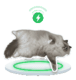
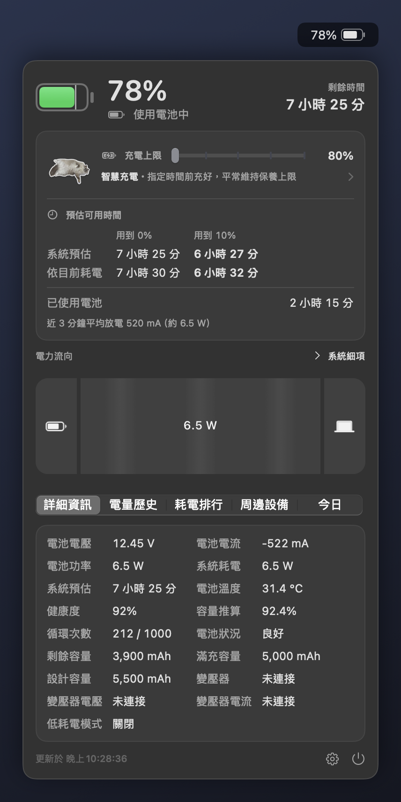
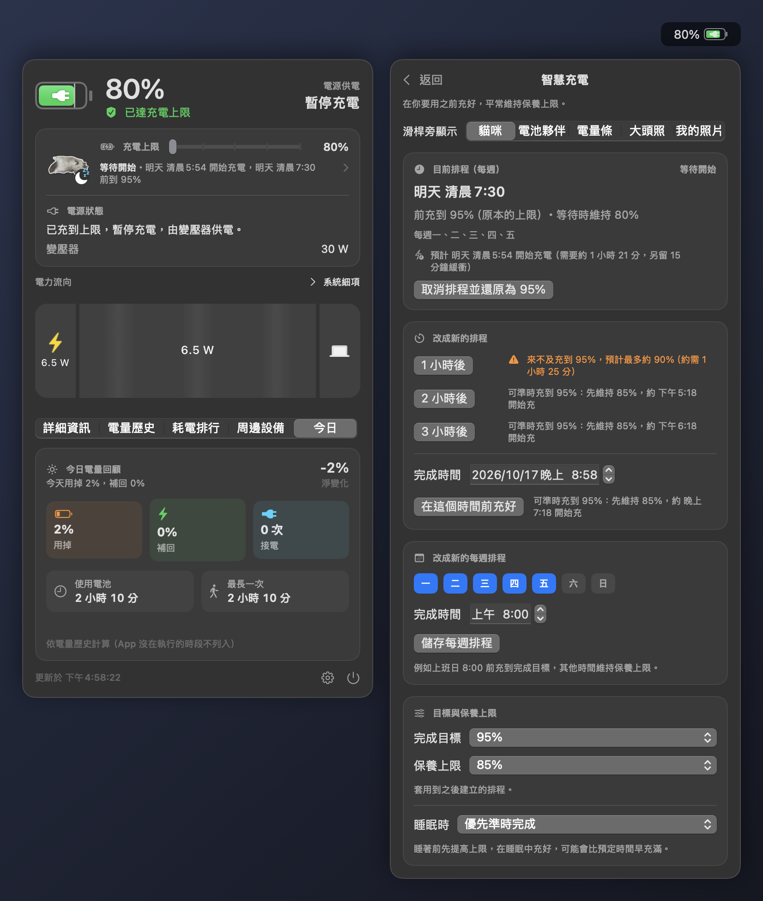
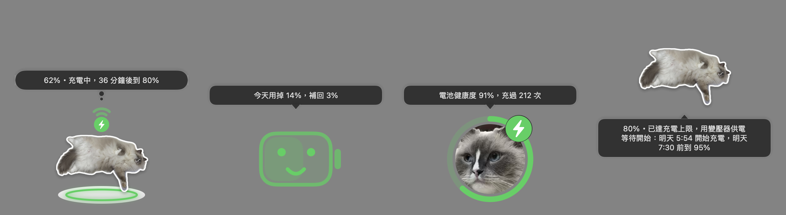
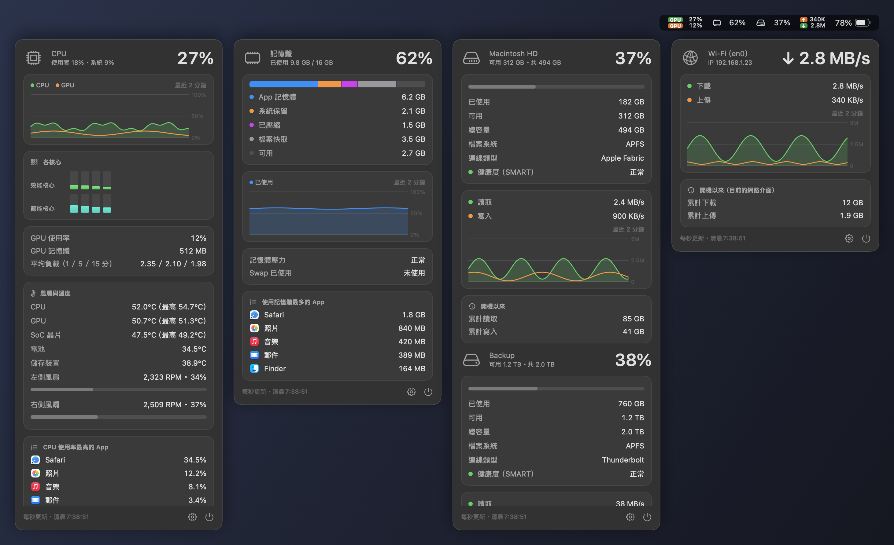
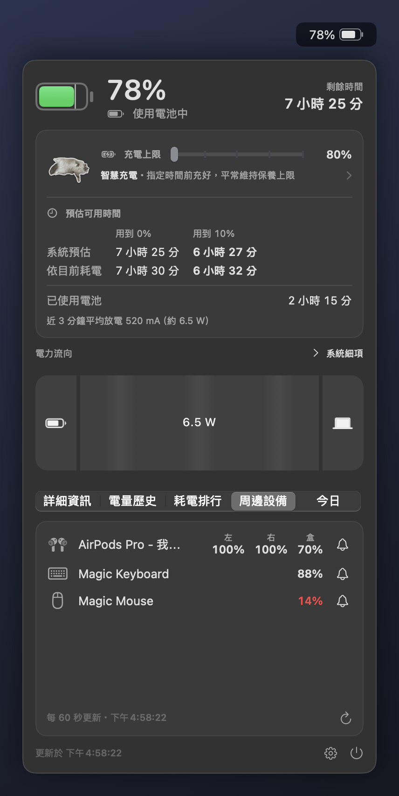

<div align="center">


# 電池與系統監控

**macbookBatteryMonitor**

電量、充電與 Mac 的即時狀態，都在選單列。

需要時展開細節，平常讓一隻貓咪陪著你。

[下載最新版](https://github.com/sgeric910601/macbookBatteryMonitor/releases/latest) · [快速安裝](#快速安裝) · [完整指南](docs/guide.zh-TW.md) · [English](README.en.md)

  [](https://github.com/sgeric910601/macbookBatteryMonitor/releases/latest)




<sub>轉製自 App 內建的 6 秒充電夥伴動畫；畫面不是即時電量。</sub>

</div>

---

> 文件對應目前的 **main 開發分支**。下載按鈕指向最新正式版；尚未發布的功能與實際可用項目，請以 [Release 說明](https://github.com/sgeric910601/macbookBatteryMonitor/releases) 為準。

<a id="特色"></a>

## 一眼看懂你的 Mac

| 電池與充電 | 監控與日常 |
| :--- | :--- |
| **電量與剩餘時間**：百分比、充放電狀態、健康度與循環次數 | **可選系統監控**：CPU／GPU、記憶體、磁碟與網路，按需開啟 |
| **智慧充電**：指定完成時間，先維持保養上限，再交給 macOS 充電 | **周邊設備**：藍牙鍵鼠、AirPods 左耳／右耳與充電盒電量 |
| **電力流向**：從變壓器、系統到電池，可展開硬體耗電細項 | **充電夥伴**：貓咪、電池表情或自己的照片，也能放到桌面 |
| **今日回顧**：用掉與補回的電量、接電次數、離電時間 | **省電模式**：降低更新頻率、停用動畫，監控模組可全部關閉 |

<p align="center">
  
</p>

<p align="center"><sub>介面示範資料；感測項目與可調整的充電設定會依機型和 macOS 版本不同。</sub></p>

## 下載

| 你的系統 | 安裝檔 |
| :--- | :--- |
| **macOS 14 以上** · Apple 晶片／Intel | [下載通用版 DMG](https://github.com/sgeric910601/macbookBatteryMonitor/releases/latest/download/macbookBatteryMonitor.dmg) |
| **macOS 12／13** · Apple 晶片／Intel | [下載舊系統版 DMG](https://github.com/sgeric910601/macbookBatteryMonitor/releases/latest/download/macbookBatteryMonitor-macOS12.dmg) |

已安裝 v1.7.2 以後的版本？到 **設定 → 更新 → 一鍵更新** 即可，設定與歷史資料會保留。v2.0.0 起 Release 不再附 ZIP：v1.7.1 會先一鍵更新到 v1.7.7（舊系統版本是 v1.7.2），再按一次就到最新版；v1.5.0～v1.6.2 請下載上面的 DMG 安裝一次。

<a id="安裝"></a>

### 快速安裝

1. 下載對應的 DMG，打開後把 App 拖到「應用程式」。
2. 退出 DMG，再從「應用程式」啟動。
3. 若 macOS 阻擋首次開啟，到 **系統設定 → 隱私權與安全性 → 強制打開**。
4. 選擇「只看電池」或「電池＋系統監控」，依需要允許通知與藍牙；管理員 CPU 取樣是選用功能。

<details>
<summary>首次開啟仍被阻擋，或需要了解權限？</summary>

確認下載來源是本專案官方 Release 後，也可使用：

```bash
xattr -dr com.apple.quarantine /Applications/macbookBatteryMonitor.app
```

官方版使用固定的專用簽章憑證，但不是 Apple 開發者簽章。不同功能需要的權限不一樣；詳見 [安裝與權限說明](docs/guide.zh-TW.md#安裝)。

</details>

<a id="使用方式"></a>

## 三個值得打開的畫面

<a id="智慧充電"></a>

### 01 · 把充電安排在出門之前

設定 1／2／3 小時後、自訂時間或每週排程。等待期間維持保養上限，需要時再提高目標；完成、取消與還原都有狀態提示。



**實際充電由 macOS 控制。** 自動調整上限只在支援的 Mac 上提供，系統溫度保護等機制仍可能暫停充電，不保證準時充滿。[了解排程與睡眠策略 →](docs/guide.zh-TW.md#智慧充電)

<a id="充電夥伴"></a>
<a id="桌面寵物"></a>

### 02 · 讓充電夥伴住在桌面

貓咪會跟著充電狀態變化；桌面寵物支援拖曳、大小調整與互動。也可以換成電池角色、貓咪大頭照或自己的照片。



[充電夥伴外觀 →](docs/guide.zh-TW.md#充電夥伴) · [桌面互動與動畫耗電 →](docs/guide.zh-TW.md#桌面寵物)

<a id="系統監控"></a>
<a id="周邊設備"></a>

### 03 · 需要多少資訊，就開多少

只看電池時可以關閉全部系統監控；需要分析時，再打開 CPU／GPU、記憶體、磁碟或網路。選單列放不下，也能合併圖示。

<details>
<summary>展開系統監控與周邊設備畫面</summary>





[系統監控細節 →](docs/guide.zh-TW.md#系統監控) · [周邊設備提醒 →](docs/guide.zh-TW.md#周邊設備)

</details>

## 個人化與可選工具

**選單列圖示自訂**：在「設定 → 顯示項目」選白色／黑色／自動百分比，搭配原生綠、預設色票或自訂色盤。底色不透明度與充電流光可分別調整；填色維持實際電量比例。

<details>
<summary>展開 main 分支的其他可選工具</summary>

| 類型 | 功能與指南 |
| :--- | :--- |
| 電源與裝置 | [防止休眠與擴充管理](docs/guide.zh-TW.md#擴充功能)、[音訊切換](docs/guide.zh-TW.md#音訊切換)、[監控警示](docs/guide.zh-TW.md#監控警示) |
| 輸入與操作 | [滑鼠／觸控板捲動](docs/guide.zh-TW.md#滑鼠與觸控板的捲動方向)、[滑鼠側鍵](docs/guide.zh-TW.md#滑鼠側鍵)、[鍵盤清潔](docs/guide.zh-TW.md#鍵盤清潔模式)、[中文輸入法](docs/guide.zh-TW.md#中文輸入法) |
| 視窗與桌面 | [視窗切換](docs/guide.zh-TW.md#視窗切換)、[視窗吸附](docs/guide.zh-TW.md#視窗吸附)、[貓咪快捷選單](docs/guide.zh-TW.md#貓咪快捷選單) |
| 管理與維護 | [登入項目](docs/guide.zh-TW.md#登入項目)、[設定備份與權限](docs/guide.zh-TW.md#設定備份與權限)、[Port 管理](docs/guide.zh-TW.md#port-管理與結束程式)、[剪貼簿歷史](docs/guide.zh-TW.md#剪貼簿歷史) |

這些工具依需要開啟；詳細的機型、權限與系統版本限制都保留在指南中。

</details>

## 資料、效能與問題排查

| 想知道什麼？ | 從這裡開始 |
| :--- | :--- |
| 功耗數字怎麼算、哪些是估算？ | [電力流向怎麼算](docs/guide.zh-TW.md#電力流向怎麼算) · [資料來源](docs/guide.zh-TW.md#資料來源) |
| 更新頻率、動畫與背景取樣？ | [效能與省電](docs/guide.zh-TW.md#效能與省電) |
| 更新失敗或捲動方向沒作用？ | [一鍵更新](docs/guide.zh-TW.md#一鍵更新) · [捲動排查](docs/guide.zh-TW.md#捲動反向沒作用時) |
| 設定存在哪、如何完整移除？ | [資料存放位置](docs/guide.zh-TW.md#資料存放位置) · [解除安裝](docs/guide.zh-TW.md#解除安裝) |
| 查看新版與回報問題？ | [Releases](https://github.com/sgeric910601/macbookBatteryMonitor/releases) · [Issues](https://github.com/sgeric910601/macbookBatteryMonitor/issues) |

一般電池、功耗與周邊讀數主要來自本機系統；[網路測速](docs/guide.zh-TW.md#系統監控) 會連到 Apple 伺服器、可能使用數百 MB 流量，只在手動啟動時執行。一鍵更新會連線至 GitHub。

<a id="從原始碼編譯"></a>
<a id="開發"></a>

## 編譯與貢獻

```bash
git clone https://github.com/sgeric910601/macbookBatteryMonitor.git
cd macbookBatteryMonitor
DEVELOPER_DIR=/Applications/Xcode.app/Contents/Developer ./build.sh
./Scripts/test-power.sh
```

目前 main 建議使用完整 Xcode。若 Command Line Tools 缺少 SwiftUI 巨集外掛，請使用上方的 `DEVELOPER_DIR` 指令；舊系統版位於 `legacy-macos12` 分支。

[完整編譯說明](docs/guide.zh-TW.md#從原始碼編譯) · [除錯與發布流程](docs/guide.zh-TW.md#開發) · [版本沿革](docs/guide.zh-TW.md#舊版本)

<a id="致謝"></a>
<a id="授權"></a>

## 致謝與授權

感謝 [@melvin0kuo](https://github.com/melvin0kuo)、[@liaw-boy](https://github.com/liaw-boy) 與其他貢獻者。[完整貢獻紀錄 →](docs/guide.zh-TW.md#致謝)

Copyright © 2026 TSENG KUAN-CHENG 及各貢獻者，保留所有權利。**原始碼公開不代表開源授權**；官方 Release 可免費使用，自行修改與貢獻的條件請閱讀 [LICENSE](LICENSE)。貓咪照片與動畫的權利屬於各素材權利人；本頁 GIF 由專案既有素材轉製，不另授權。
